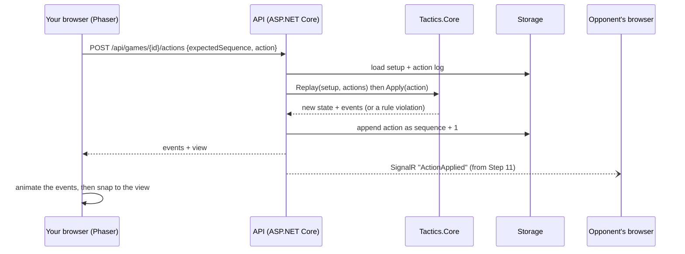

# Tactics Duel — Build Plan

A two-player, turn-based fantasy tactics game that runs in the browser.
**The server is the referee** (ASP.NET Core + a pure C# rules engine). **The browser is the view** (Phaser 4 + TypeScript).
It's built in small steps, each followed by a learning report.

> **For Claude Code:** this file is the source of truth. Follow the step workflow in `CLAUDE.md`, one step at a time.
> "Tactics Duel" is a working title. All numbers, names and layouts marked *placeholder* are mine to change later.

---

## Progress
- [x] Step 0 — Project setup & tooling
- [x] Step 1 — Game state model (C#)
- [ ] Step 2 — Movement & pathfinding (C#)
- [ ] Step 3 — Attack & heal (C#)
- [ ] Step 4 — Turns, victory & replay (C#)
- [ ] Step 5 — Game server v1 (in-memory API)
- [ ] Step 6 — Phaser 101: draw the board
- [ ] Step 7 — Input: select, move, act, end turn
- [ ] Step 8 — Game feel: animations & HUD
- [ ] Step 9 — Art & sound pipeline (my style, my choice)
- [ ] Step 10 — Lobby: create, invite, join
- [ ] Step 11 — Real-time with SignalR
- [ ] Step 12 — Persistence with PostgreSQL
- [ ] Step 13 — Docker & CI
- [ ] Step 14 — Deploy & portfolio polish ← **v1 shipped**

---

## 1. The game (v1 rules)

### Board
- A grid of 8×8 tiles (comes from the scenario file).
- Coordinates are `(x, y)`, with the origin at the **top-left**. `x` grows to the right and `y` grows **down**, like screen pixels.
- Obstacles are impassable tiles. In v1 they don't block attacks (no line of sight).

### Players
- Player **One** starts at the bottom and plays first. Player **Two** starts at the top.
- Everyone can see everything (no hidden information).

### Units (*placeholder* stats, stored in `content/units.json`)

| Unit | Max HP | Power | Defense | Move | Range (min–max) | Ability |
|---|---|---|---|---|---|---|
| Warrior | 28 | 10 | 3 | 3 | 1–1 | Damage |
| Archer | 18 | 8 | 1 | 3 | 2–3 | Damage |
| Mage | 14 | 12 | 0 | 2 | 1–2 | Damage |
| Healer | 16 | 5 | 1 | 3 | 1–2 | Heal |

### A turn
On your turn, each of your units can **Move once**, then **Act once**. Both are optional. Acting ends that unit's activity, so it can't move after acting.

- **Move:** up to `move` tiles in 4 directions (no diagonals). The unit only passes through empty tiles (no units, no obstacles, not off the board) and must end on an empty tile. It takes the shortest path, found by BFS.
- **Act, damage ability:** target a living **enemy** whose Manhattan distance is between `minRange` and `maxRange`.
  - Damage = `max(1, attacker.power − target.defense)`.
  - HP never goes below 0. A unit at 0 HP is **defeated** and removed from the board.
- **Act, heal ability:** target an **injured ally** (HP < max HP) in range. `minRange ≥ 1`, so a healer can't heal itself.
  - Heal = `min(power, maxHp − hp)`.
- **End turn:** you can end your turn at any time. The other player's units get their move and act back, and the turn number goes up by 1.

### Victory
When a player has no units left, the other player wins. The game is then `finished` and every further action is rejected.

### Determinism
v1 has no randomness. The same start plus the same actions always gives the same result.

### Classic scenario (*placeholder*, `content/scenarios/classic.json`)
Uppercase letters are Player One, lowercase are Player Two, `#` is an obstacle.
W/w = warrior, A/a = archer, M/m = mage, H/h = healer.
```
     x: 0 1 2 3 4 5 6 7
y=0     . h . m . . a .
y=1     . . . . w . . .
y=2     . . . . . # . .
y=3     . . # . . . . .
y=4     . . . . . # . .
y=5     . . # . . . . .
y=6     . . . W . . . .
y=7     . A . . M . H .
```
The layout is point-symmetric: a tile `(x, y)` mirrors to `(7−x, 7−y)`. Unit ids: `one-warrior`, `one-archer`, `one-mage`, `one-healer`, `two-warrior`, …
The same text format is used by the `AsciiBoard` test helper (Step 1).

---

## 2. Architecture

### Who does what
- **`Tactics.Core`** (C#, pure) holds the rules: state, validation, applying actions, events, pathfinding, replay.
- **`Tactics.Api`** (ASP.NET Core) handles players, tokens, storage, HTTP endpoints and the SignalR hub. It calls Core for every rule decision.
- **`client/`** (Phaser 4 + TypeScript) draws the game, handles input, plays animations and talks to the API.
- **`Tactics.AppHost`** (Aspire) runs everything locally with one command (API, Vite dev server, Postgres from Step 12).

### What happens when you make a move


### Repo layout (target)
```
tactics-duel/
├─ CLAUDE.md · PLAN.md · START_HERE.md · README.md
├─ .claude/skills/          # /next-step, /explain + official Phaser skills (Step 0)
├─ content/                 # game data I edit: units.json, scenarios/*.json
├─ docs/
│  ├─ learning/             # README.md (index), GLOSSARY.md, step-NN-*.md
│  ├─ CREATIVE_HOOKS.md
│  ├─ DECISIONS.md
│  └─ ART_GUIDE.md          # Step 9
├─ src/
│  ├─ Tactics.Core/         # pure rules, BCL only
│  ├─ Tactics.Api/          # endpoints, services, hub, persistence
│  ├─ Tactics.AppHost/      # Aspire orchestration (dev)
│  └─ Tactics.ServiceDefaults/
├─ tests/
│  ├─ Tactics.Core.Tests/
│  └─ Tactics.Api.Tests/
├─ client/                  # Vite + TypeScript + Phaser 4
│  ├─ public/assets/        # my art & sounds go here (Step 9)
│  └─ src/
│     ├─ main.ts · config.ts
│     ├─ scenes/            # BootScene, MenuScene, GameScene, HudScene
│     ├─ game/              # types, grid, BoardRenderer, UnitSprite, EventPlayer, InputController
│     ├─ net/               # ApiClient, RealtimeClient, session
│     └─ media/             # visuals.ts, sounds.ts: art & sound mapping (Step 9)
├─ Directory.Build.props · Directory.Packages.props · global.json
└─ Dockerfile · .github/workflows/ci.yml   # Step 13
```
Folder and file names can change if there's a good reason. Log the reason in `docs/DECISIONS.md`.

---

## 3. Contracts (shared shapes)
JSON is camelCase. Enums are camelCase strings (`"one"`, `"inProgress"`). Polymorphic types carry a `"type"` discriminator.
C# uses `System.Text.Json` with `[JsonPolymorphic]` / `[JsonDerivedType]`. TypeScript uses discriminated unions on `type`.
API DTOs live in `Tactics.Api/Contracts`, separate from the Core records. The client mirrors them in `client/src/game/types.ts`.

### GameView, returned by `GET /api/games/{id}` and after every action
```jsonc
{
  "gameId": "0b8f…",
  "sequence": 12,                 // number of actions applied so far
  "yourSide": "one",              // "one" | "two"
  "currentPlayer": "two",
  "turnNumber": 4,
  "status": "inProgress",         // "inProgress" | "finished"
  "winner": null,                 // "one" | "two" | null
  "opponentJoined": true,
  "board": { "width": 8, "height": 8, "obstacles": [{ "x": 2, "y": 3 }] },
  "unitTypes": [{ "id": "archer", "name": "Archer", "maxHp": 18, "power": 8, "defense": 1,
                  "move": 3, "minRange": 2, "maxRange": 3, "ability": "damage" }],
  "units": [{ "id": "one-archer", "typeId": "archer", "owner": "one",
              "x": 1, "y": 7, "hp": 18, "hasMoved": false, "hasActed": false }],
  "availableActions": [           // only for yourSide, only on your turn, else []
    { "unitId": "one-archer", "moveTargets": [{ "x": 1, "y": 6 }], "actTargets": ["two-warrior"] }
  ]
}
```
`unitTypes` comes from **this game's own setup snapshot**, so editing `content/` never changes running games.

### Action request: `POST /api/games/{id}/actions` (header `Authorization: Bearer <playerToken>`)
```jsonc
{ "expectedSequence": 12, "action": { "type": "move", "unitId": "one-archer", "to": { "x": 1, "y": 5 } } }
{ "expectedSequence": 13, "action": { "type": "act", "actorId": "one-archer", "targetId": "two-warrior" } }
{ "expectedSequence": 14, "action": { "type": "endTurn" } }
```
Response `200`: `{ "sequence": 13, "events": [ … ], "view": { …GameView } }`

### Events (what happened, in order)
```jsonc
{ "type": "unitMoved",    "unitId": "one-archer", "from": {"x":1,"y":7}, "to": {"x":1,"y":5}, "path": [{"x":1,"y":6},{"x":1,"y":5}] }
{ "type": "unitDamaged",  "unitId": "two-warrior", "byUnitId": "one-archer", "amount": 5, "hpAfter": 23 }
{ "type": "unitHealed",   "unitId": "one-warrior", "byUnitId": "one-healer", "amount": 5, "hpAfter": 25 }
{ "type": "unitDefeated", "unitId": "two-mage" }
{ "type": "turnEnded",    "previousPlayer": "one", "nextPlayer": "two", "turnNumber": 2 }
{ "type": "gameWon",      "winner": "one" }
```
`path` excludes the start tile and includes the destination.

### Rule violation codes (from Core)
`GameOver` · `NotYourTurn` · `UnitNotFound` · `NotYourUnit` · `AlreadyMoved` · `AlreadyActed` · `DestinationNotReachable` · `TargetNotFound` · `TargetOutOfRange` · `InvalidTarget`

### Lobby
- `POST /api/games` → `201 { "gameId", "side": "one", "playerToken", "inviteCode", "view" }`
- `POST /api/games/{id}/join` with `{ "inviteCode" }` → `200 { "gameId", "side": "two", "playerToken", "view" }`
- Invite link format: `https://<host>/?game=<gameId>&invite=<inviteCode>`

### HTTP errors (always ProblemDetails)
| Status | When | `code` extension |
|---|---|---|
| 400 | malformed request | — |
| 401 | missing or invalid player token | — |
| 403 | wrong invite code | `InvalidInviteCode` |
| 404 | game not found | — |
| 409 | `expectedSequence` ≠ current sequence · seat two already taken | `SequenceConflict` · `AlreadyJoined` |
| 422 | rule violation | one of the rule violation codes |

Example: `{ "title": "Rule violation", "status": 422, "code": "TargetOutOfRange", "detail": "Archer hits targets 2–3 tiles away; this target is 1 tile away." }`

---

## 4. Steps

Every step lists **Build**, **Checks**, **Done when**, **See it yourself**, what the **learning report must explain**, and the **creative hooks** it adds.

---

### Step 0 — Project setup & tooling
**Goal:** an empty skeleton that runs. The solution builds, tests run, a Phaser canvas shows a message from the API, and one command starts everything.
**Why:** a working pipeline from day one, so every later step is "add a feature", not "fight the tooling".

**Build**
1. **Prerequisites check** (report only, install nothing system-wide without my OK): `dotnet --list-sdks` (needs 10.0.x), `node -v` (LTS 22+), `npm -v`, `git --version`, `docker --version` (Docker Desktop or Podman, needed from Step 12; check now), `aspire --version` (Aspire CLI, see aspire.dev). For anything missing, give me official install links.
2. **Repo basics:** `git init`, `.gitignore` (dotnet + node + IDEs + `.env`), `.editorconfig`, and a `global.json` that pins SDK 10.0.x with `rollForward: latestFeature` and opts `dotnet test` into Microsoft.Testing.Platform: `"test": { "runner": "Microsoft.Testing.Platform" }`. The `xunit3` template uses that runner, and the .NET 10 SDK only runs it in this mode.
3. **.NET solution:**
   - `Directory.Build.props`: `net10.0`, `Nullable`, `ImplicitUsings`, `TreatWarningsAsErrors` for `src/` projects.
   - `Directory.Packages.props`: Central Package Management.
   - Projects:
     - `src/Tactics.Core` (classlib)
     - `src/Tactics.Api` (web, Minimal API)
     - `src/Tactics.ServiceDefaults` and `src/Tactics.AppHost` (use the current Aspire templates/CLI; check aspire.dev)
     - `tests/Tactics.Core.Tests` and `tests/Tactics.Api.Tests`: run `dotnet new install xunit.v3.templates`, then `dotnet new xunit3 -f net10.0`
   - Add a solution file at the root with every project. `dotnet test` at the root must run all tests.
   - The API calls `AddServiceDefaults()` + `MapDefaultEndpoints()` and exposes `GET /api/hello` → `{ "message": "API is alive" }` (the server never needs the game title; see the naming rule in `CLAUDE.md`).
   - Add one smoke test per test project.
4. **Client:**
   - Scaffold with `npm create vite@latest client -- --template vanilla-ts --no-interactive --no-immediate` (no prompts; don't install or start the dev server yet). If it still prompts, create the few files by hand.
   - In `client/`: `npm i phaser@^4` and `npm i -D vitest`. Remove the Vite demo boilerplate (counter, logos, demo CSS).
   - `src/config.ts` exports `GAME_TITLE = "Tactics Duel"`, the only place in code where the title is written (naming rule in `CLAUDE.md`). The page `<title>` comes from it too.
   - `src/main.ts` creates a `Phaser.Game`: WebGL, base size 960×640, `Scale.FIT` + `CENTER_BOTH`. It has one `BootScene` that writes `GAME_TITLE` and the message from `GET /api/hello`. This proves browser → proxy → API.
   - npm scripts: `dev`, `build`, `typecheck` (`tsc --noEmit`), `test` (`vitest run`).
   - `vite.config.ts`: proxy `/api` to the API URL that Aspire injects through environment variables (check the aspire.dev JavaScript docs for the exact names). Fall back to the API's launchSettings URL when run without Aspire. `/hubs` with `ws: true` comes in Step 11.
5. **Phaser agent skills:** copy every folder from `client/node_modules/phaser/skills/` into `.claude/skills/`, keeping the names. Confirm `v3-to-v4-migration` is there. If the folder is missing, tell me; the fallback is `npx skills add phaserjs/phaser --agent claude-code`.
6. **Aspire AppHost:** add the API project, plus the client through `Aspire.Hosting.JavaScript` → `AddViteApp("client", "../../client")` with `.WithReference(api).WaitFor(api)`.
7. **Docs skeleton:**
   - `README.md`: pitch and how to run.
   - `docs/learning/README.md`: an index table (step · report · one-line summary).
   - `docs/learning/GLOSSARY.md`.
   - `docs/CREATIVE_HOOKS.md`: a table (hook · where · since step). First row: the game's title (`GAME_TITLE` in `client/src/config.ts`).
   - `docs/DECISIONS.md`. First entries: Phaser 4 · server as referee · .NET 10 LTS rather than .NET 11 (both are supported until November 2028, since STS releases now get 24 months, but the ecosystem is still catching up: Npgsql's EF Core 11 provider is a release candidate) · Aspire · PostgreSQL.
   - `content/README.md`: "this folder is game data you can edit".
8. Fill in the **Commands** section of `CLAUDE.md` with the real commands.

**Checks:** `dotnet build` (0 warnings) · `dotnet test` · in `client/`: `npm run typecheck`, `npm test`, `npm run build` · `aspire run` starts the API and client, and the dashboard shows both running.
**Done when:** all checks pass, and the browser shows the canvas with the game title and the API message, with the title in the browser tab too.
**See it yourself:** `aspire run` → open the dashboard link in the terminal → click the client's URL.
**Learning report must explain:**
- The repo map (what lives where, and why).
- Vite (≈ `ng serve` + bundler).
- Phaser: a framework (renderer, scenes, input, tweens, loader), not an editor-based engine like Unity or Godot.
- Canvas vs WebGL, in one line each.
- Aspire (≈ docker-compose + dashboard + service discovery).
- How the browser reaches the API in dev (the proxy).
- Central Package Management.

**Creative hooks:** the game's name.

---

### Step 1 — Game state model (C#)
**Goal:** describe a whole game as plain immutable data, loaded from JSON.
**Why:** everything else (rules, API, screen) reads this model. Getting it right makes the rest simple.

**Build**
1. Domain types in `Tactics.Core`. `System.Collections.Immutable` is part of the BCL, so it's allowed.
   - `Position(int X, int Y)`, a readonly record struct with:
     - `ManhattanTo(Position)`
     - `Neighbors()` in a **fixed order** (up, right, down, left), which keeps BFS deterministic
   - `PlayerSide { One, Two }` with an `Opponent()` extension. `Ability { Damage, Heal }`. `GameStatus { InProgress, Finished }`.
   - `UnitType(Id, Name, MaxHp, Power, Defense, Move, MinRange, MaxRange, Ability)`
   - `Unit(Id, TypeId, Owner, Position, Hp, HasMoved, HasActed)`
   - `Board(Width, Height, ImmutableHashSet<Position> Obstacles)` with `Contains(Position)` and `IsObstacle(Position)`
   - `UnitPlacement(Id, TypeId, Owner, Position)` and `GameSetup(ScenarioId, Board, ImmutableDictionary<string, UnitType> UnitTypes, ImmutableList<UnitPlacement> Placements)`
   - `GameState(Board, UnitTypes, ImmutableList<Unit> Units, CurrentPlayer, TurnNumber, Status, Winner?)` with helpers `UnitAt(Position)`, `FindUnit(id)`, `TypeOf(unit)` and `UnitsOf(side)`
2. `ContentLoader.Load(string unitsJson, string scenarioJson)` → `GameSetup`. It validates:
   - unknown unit type
   - duplicate ids
   - placement off the board, on an obstacle, or overlapping another unit
   - `minRange > maxRange`
   - non-positive stats

   Error messages must be human-friendly, because I'll trigger them by editing JSON.
3. `TacticsJson.Options`: one shared `JsonSerializerOptions` (camelCase, enums as camelCase strings).
4. `GameEngine.CreateInitialState(GameSetup)` → turn 1, Player One to play.
5. Content files: `content/units.json` (format `{ "unitTypes": [ … ] }`) and `content/scenarios/classic.json` (format `{ "id", "name", "board": { "width", "height", "obstacles": [...] }, "placements": [ { "id", "typeId", "owner", "x", "y" } ] }`). Use exactly the *placeholder* values from section 1.
6. Test helper `AsciiBoard.Parse(string map)` → `GameState`, using the legend from section 1 and default unit types. Every later rule test uses it.

**Checks:** `dotnet build` (0 warnings) · `dotnet test`, which must include:
- the real `content/` files load and pass validation (this catches my JSON mistakes, and runs in CI later)
- each invalid case gives its specific error
- `AsciiBoard` builds the expected state
- the initial state is right (turn 1, Player One, 8 units)

**Done when:** all checks pass. Every public Core type has a short XML doc comment.
**See it yourself:** run the tests, then open `content/units.json` and `content/scenarios/classic.json`. The tests prove that's the whole game data.
**Learning report must explain:**
- Game state vs what's drawn on screen.
- Immutability and `with`, and why games love it (undo, replay, safe tests).
- Grid coordinates: origin top-left, y grows down, like pixels.
- Data-driven design.
- Why Core has zero dependencies.

**Creative hooks:** `content/units.json` (stats, new unit types) · `content/scenarios/*.json` (board size, obstacles, starting positions).

---

### Step 2 — Movement & pathfinding (C#)
**Goal:** units can move, and the engine knows every tile a unit can reach.
**Why:** this is the first real game algorithm, BFS on a grid. Most tactics games use it.

**Build**
1. `Pathfinding.Reachable(GameState, Unit)` → a `ReachMap`:
   - BFS flood fill over `Neighbors()`, at most `Move` steps.
   - Blocked by obstacles, by any other unit, and by the board edge.
   - Stores a "came-from" entry per tile, so `ReachMap.PathTo(destination)` can rebuild the shortest path.
   - The start tile isn't a destination.
2. Actions are commands as data. Abstract record `GameAction(PlayerSide Player)` with `MoveAction(Player, UnitId, To)`. JSON discriminator `"move"`.
3. Events: abstract record `GameEvent`, with `UnitMoved(UnitId, From, To, Path)`.
4. `ActionResult` is either `Accepted(GameState State, ImmutableList<GameEvent> Events)` or `Rejected(RuleViolation Code, string Message)`. Use a closed hierarchy and switch expressions.
5. `GameEngine.Apply(GameState, GameAction)`:
   - **Validate:** game in progress → it's that player's turn → the unit exists and is theirs → it hasn't moved or acted → the destination is reachable.
   - **Apply:** set the new position and `HasMoved = true`, and emit `UnitMoved` with its path.

**Checks:** `dotnet test` with ASCII-board tests for:
- range on an open board (the diamond shape, with an exact tile count)
- obstacles block, units block (friend or enemy), board edges
- the path is shortest and every step is adjacent
- every rejection code for Move

**Done when:** all checks pass. `Apply` never throws for an invalid action; it returns `Rejected`.
**See it yourself:** run the tests. The report includes an ASCII picture of BFS distances from one unit.
**Learning report must explain:**
- Grid movement and Manhattan distance.
- BFS flood fill and path reconstruction with "came-from". Use an ASCII picture of the distance numbers.
- The command pattern (actions as data, ≈ a CQRS command).
- Validate, then apply.
- Events as "what happened".

**Creative hooks:** movement rules (diagonals, passing through allies, terrain costs later with Dijkstra).

---

### Step 3 — Attack & heal (C#)
**Goal:** units damage enemies or heal allies, and defeated units leave the board.
**Why:** combat is where the game becomes a game. Putting every balance formula in one place makes it easy to tune.

**Build**
1. `ActAction(Player, ActorId, TargetId)`, discriminator `"act"`.
2. `Combat.cs` has `CalculateDamage(attackerType, targetType)` and `CalculateHeal(healerType, target)`. These are the **only** places with formulas (section 1).
3. Validation:
   - the target exists
   - it's in range (Manhattan distance within `[MinRange, MaxRange]`)
   - Damage → the target is an enemy; Heal → it's an injured ally
   - the actor hasn't acted
4. Apply:
   - Update HP and set `HasActed = true` and `HasMoved = true`.
   - Emit `UnitDamaged` or `UnitHealed`.
   - If HP hits 0, emit `UnitDefeated` and remove the unit. Order: damaged → defeated.

**Checks:** `dotnet test` covering:
- every rejection code for Act
- the damage minimum of 1 and the heal cap
- defeat removes the unit, and events come in order
- moving then acting is allowed; acting then moving is rejected (`AlreadyActed`)

**Done when:** all checks pass.
**See it yourself:** run the tests, then change a number in `Combat.cs` and watch the right tests fail.
**Learning report must explain:**
- Targeting and range.
- Deterministic combat formulas.
- Event ordering.
- "One place for game balance".
- Why the server computes damage, never the client.

**Creative hooks:** `Combat.cs` (critical hits later, elemental bonuses, counter-attacks) · new abilities.

---

### Step 4 — Turns, victory & replay (C#)
**Goal:** a complete game playable in pure C#. Turns alternate, a winner is detected, and any game can be rebuilt from its action list.
**Why:** replay is what lets the server store only actions (Step 12), and it's a strong portfolio talking point.

**Build**
1. `EndTurnAction(Player)`, discriminator `"endTurn"`:
   - reset `HasMoved`/`HasActed` for the next player's units
   - switch `CurrentPlayer` and add 1 to `TurnNumber`
   - emit `TurnEnded`
2. After every accepted action, check victory. If a side has no units: `Status = Finished`, set `Winner`, emit `GameWon`. Any later action → `GameOver`.
3. `GameEngine.GetAvailableActions(GameState, PlayerSide)` → for each unit: `MoveTargets` (if it can still move) and `ActTargets` (if it can still act, measured from its current position). Return an empty list when it isn't that player's turn or the game is over.
4. `GameEngine.Replay(GameSetup, IEnumerable<GameAction>)` → the final state. A rejected action throws, because a corrupted log is a bug.
5. JSON round-trip for every action and event type through `TacticsJson.Options`, with discriminators.

**Checks:** `dotnet test` covering:
- turn switching and flag reset
- victory and `GameOver` afterwards
- available actions on known ASCII boards
- the JSON round-trip
- a **scripted full game**: a short sequence to victory, then `Replay` gives an identical final state. **Gotcha:** records compare `ImmutableList` members by reference, so compare by serializing both states to JSON, or with a structural comparer.

**Done when:** all checks pass, and the scripted game test reads like a story.
**See it yourself:** run the scripted game test and read it top to bottom. It's the whole game with no UI.
**Learning report must explain:**
- The turn state machine.
- Win conditions.
- Determinism (why there's no `Random` or `DateTime` in the rules).
- Event sourcing lite (state = replay of actions).
- Record equality with collections.
- Serialization contracts.

**Creative hooks:** win conditions (capture a tile, survive N turns) · turn limits.

---

### Step 5 — Game server v1 (in-memory API)
**Goal:** a real HTTP API that runs the rules. The client will only talk to it, so rules never get duplicated in TypeScript.
**Why:** an authoritative server is how online games stop cheating. Swapping in a database later is a single class.

**Build**
1. `Tactics.Api` references Core. At startup it loads `content/` (copied to the build output) into a singleton `SetupProvider`, with default scenario `classic`.
2. `IGameRepository` + `InMemoryGameRepository`. Each game stores:
   - id
   - **setup snapshot**
   - token hashes for both players
   - invite code
   - the ordered action list

   Use a per-game lock. Inject `TimeProvider` for timestamps.
3. `GameService` with:
   - `CreateGame`
   - `JoinGame`
   - `GetView(gameId, token)`
   - `SubmitAction(gameId, token, expectedSequence, actionDto)`: load → `Replay` → check `expectedSequence == actions.Count` → build the Core action with the **player taken from the token** → `Apply` → append → return events + view
4. Tokens and invite codes:
   - Player token: 32 random bytes (`RandomNumberGenerator`), base64url. Store only its SHA-256 hash and compare in constant time.
   - Invite code: 8 characters from an unambiguous alphabet.
5. Endpoints (`MapGroup("/api")`), following the Contracts section:
   - `POST /games`
   - `POST /games/{id}/join`
   - `GET /games/{id}`
   - `POST /games/{id}/actions`

   Read the token from `Authorization: Bearer …` with a small helper or endpoint filter. No ASP.NET Identity.
6. ProblemDetails everywhere (`AddProblemDetails`), with the status and `code` mapping from the Contracts section.
7. DTOs in `Contracts/` with explicit mapping from Core, and `GameView.availableActions` filled from `GetAvailableActions`.
8. OpenAPI: the built-in `AddOpenApi()` / `MapOpenApi()`, plus the Scalar UI (`Scalar.AspNetCore`) in Development.
9. `client/src/game/types.ts`: TypeScript mirrors of every DTO, with discriminated unions for actions and events.

**Checks:** `dotnet test` with `WebApplicationFactory` tests (xUnit v3) for:
- create → join → get → move happy path
- missing or wrong token → 401
- wrong invite code → 403
- joining twice → 409 `AlreadyJoined`
- playing out of turn → 422 `NotYourTurn`
- stale `expectedSequence` → 409 `SequenceConflict`
- a JSON shape check of `GameView` (camelCase, discriminators, `availableActions` empty for the waiting player)

Plus `npm run typecheck` for `types.ts`.

**Done when:** all checks pass, and a full game can be played through Scalar.
**See it yourself:** `aspire run` → API → `/scalar` → create a game, join it, then post a move with each token.
**Learning report must explain:**
- The authoritative server: what a cheating client could do otherwise.
- Request/response vs a real-time tick loop, and why turn-based games don't need ticks.
- Optimistic concurrency with a sequence number (double clicks, two tabs).
- DTO vs domain.
- Capability tokens instead of accounts.
- Why `unitTypes` comes from the game's snapshot.

**Creative hooks:** a scenario choice at game creation (for later).

---

### Step 6 — Phaser 101: draw the board
**Goal:** the browser shows the real game from the server: board, obstacles, 8 units with HP bars.
**Why:** this is where game-dev basics start: the game loop, scenes, game objects, and coordinates.

**Build**
1. `config.ts`:
   - `TILE_SIZE = 64`, board origin, base size
   - `PLACEHOLDER_THEME`: neutral tiles, two plain debug team colours, highlight colours, all clearly marked PLACEHOLDER
   - a `PIXEL_ART` flag (default `false`, documented)
2. `main.ts`: the game config with scenes `[BootScene, GameScene, HudScene]`. `HudScene` can be empty for now.
3. `BootScene` **generates placeholder textures at runtime**, for example with Graphics → texture (check the Phaser 4 skills): tile, obstacle, unit body, highlight. No image files at all. Then it starts `GameScene`.
4. `game/grid.ts`: `tileToWorld(pos)` (the tile's centre), `worldToTile(x, y)` (null outside the board) and `posKey(pos)`. Pure functions with Vitest tests.
5. `net/ApiClient.ts`: a typed `fetch` wrapper that adds the Bearer token, parses ProblemDetails into a typed `ApiError`, and has no Phaser imports.
6. `net/session.ts` + **local (pass & play) mode**: `/?mode=local` creates a game, joins it as Two with the invite code, and keeps both tokens. The client always uses the token of `view.currentPlayer`. This is a real game mode (two players, one screen), not only a dev tool.
7. `game/BoardRenderer.ts`: draws tiles and obstacles once. Fixed depth layers: tiles 0, highlights 10, units 20, effects 30. The HUD lives in its own scene.
8. `game/UnitSprite.ts`: a Phaser Container with the body (team colour; check how Phaser 4 tint works, or generate one texture per team), the type letter (W/A/M/H) and an HP bar. Exposes `applyState(unit)`.
9. `GameScene.renderView(view)`: **reconciles** sprites by unit id (create / update / destroy).
10. Use `update(time, delta)` for one small thing so I see the game loop at work: a gentle idle "breathing" scale on units, driven by `time`, with a comment on frame-rate independence.

**Checks:** `npm run typecheck` · `npm test` (grid) · `npm run build` · `dotnet test` still passes.
**Done when:** the board and units match the server state, and HP bars show the right values.
**See it yourself:** `aspire run` → client URL + `/?mode=local` → the classic layout from section 1.
**Learning report must explain:**
- The game loop: boot → preload → create → `update` every frame (≈ a render loop, unlike Angular's change detection).
- Scenes (≈ routed pages that can run in parallel).
- Game objects and the display list, containers, depth/z-order.
- Textures vs sprites.
- Tile ↔ pixel conversion.
- Delta time.
- "Render from state" (reconcile ≈ Angular `trackBy`).

**Creative hooks:** board look · `UnitSprite` composition · idle animation.

---

### Step 7 — Input: select, move, act, end turn
**Goal:** a full game can be played in one browser (local mode).
**Why:** input is a state machine. Making the states explicit prevents most UI bugs in games.

**Build**
1. `game/InputController.ts`: pure TypeScript (no Phaser), so it's testable. States:
   - `Idle`
   - `UnitSelected(unitId)`
   - `Busy` (request in flight or animating)
   - `OpponentTurn`
   - `GameOver`

   It takes clicks and views and returns intents (select, request move, request act, deselect).
2. In `GameScene`: `pointerdown` → `worldToTile` → the controller. `pointermove` → hover highlight.
3. Selecting one of your units shows its `moveTargets` and `actTargets` from `view.availableActions`, **never computed on the client**.
4. Clicking a move target → POST `MoveAction` with `expectedSequence = view.sequence` → on success, replace the view and re-render (no animation yet). The unit stays selected if it can still act.
5. Clicking an act target → POST `ActAction`.
6. `Esc` or clicking an empty tile → deselect. The `E` key (and a temporary on-canvas text button) → `EndTurn`.
7. Errors: 422 → show the message as temporary on-canvas text. 409 → fetch the view again.

**Checks:** Vitest for every `InputController` transition · typecheck · build · `dotnet test`.
**Done when:** I can play a full local game until one side wins.
**See it yourself:** `/?mode=local` → play both sides to victory.
**Learning report must explain:**
- Pointer events in a canvas vs DOM events.
- The client state machine (include a Mermaid state diagram).
- The thin client ("ask, don't compute").
- The request flow for one click.
- Handling conflicts.

**Creative hooks:** controls (keyboard shortcuts, right-click to cancel) · selection feedback.

---

### Step 8 — Game feel: animations & HUD
**Goal:** the game shows what happens. Units walk their path, hits flash, numbers pop up, defeated units fade, and a HUD shows whose turn it is.
**Why:** "game feel" is what separates a game from a form. The skeleton gives a hook for every effect.

**Build**
1. `game/EventPlayer.ts` plays `events[]` **one after another** (a promise queue around tweens). Input is `Busy` while it plays; when it finishes, reconcile with the final view. Per event:

   | Event | Animation |
   |---|---|
   | `unitMoved` | tween tile by tile along `path` |
   | `unitDamaged` | attacker lunges, target flashes, floating "−N", tiny camera shake |
   | `unitHealed` | floating "+N" |
   | `unitDefeated` | fade and scale out |
   | `turnEnded` | banner |
   | `gameWon` | victory overlay |

2. `game/feel.ts`: every duration, easing name and shake strength in one file, with *placeholder* values.
3. `HudScene` runs in parallel on top of `GameScene`. It shows:
   - turn number, "Your turn" or "Opponent's turn"
   - the selected unit's panel (name, HP, power, defense, move, range, from `view.unitTypes`)
   - an End Turn button
   - toasts for errors

   It talks to `GameScene` through a small typed event bus.
4. Keep `EventPlayer`'s sequencing logic testable behind an `Animator` interface.

**Checks:** a Vitest test of event ordering with a fake `Animator` · typecheck · build · `dotnet test`.
**Done when:** a local game plays with animations, and spam-clicking during an animation does nothing.
**See it yourself:** `/?mode=local` → attack until a unit is defeated.
**Learning report must explain:**
- Tweens and easing.
- Sequencing async animations.
- "Events for animation, state for truth".
- Scene layering (HUD over game).
- Locking input during animation.
- What "juice" means.

**Creative hooks:** `feel.ts` · effects per event · HUD layout.

---

### Step 9 — Art & sound pipeline (my style, my choice)
**Goal:** make the code art-ready, and give me a map of where to find art styles and assets. **Don't choose any style for me.**
**Why:** the code shouldn't care what the art looks like. Swapping art should mean "drop files + edit a manifest".

**Build**
1. Create `client/public/assets/` with `units/`, `tiles/`, `ui/`, `audio/`, `fonts/` and `manifest.json`, which lists optional images, spritesheets (frame size, animations) and sounds by key. Leave it empty by default.
2. `BootScene` loads whatever the manifest lists. Anything missing falls back to the generated placeholders (today's behaviour).
3. `src/media/visuals.ts` maps a unit type id → texture key and optional animation keys (`idle`, `walk`, `attack`, `hit`). It works with a single image or a spritesheet and degrades gracefully.
4. `src/media/sounds.ts` maps an event type → sound key, and only plays sounds that exist. Add a master volume and a mute toggle (`M` key).
5. `config.ts`: document `TILE_SIZE` (match it to your art), `PIXEL_ART` (crisp scaling) and `roundPixels`.
6. `docs/ART_GUIDE.md`, written for me:
   1. **What the code expects:** sizes, spritesheet frame layout, naming, two `manifest.json` examples.
   2. **Where to explore styles and find assets.** Check every link is live (fetch it), drop dead ones, and describe each neutrally:
      - itch.io game assets — https://itch.io/game-assets (filters: free, fantasy, pixel-art, top-down)
      - Kenney — https://kenney.nl/assets (CC0)
      - OpenGameArt — https://opengameart.org (licences vary per asset)
      - CraftPix freebies — https://craftpix.net/freebies
      - Lospec palettes and tutorials — https://lospec.com/palette-list · https://lospec.com/pixel-art-tutorials
      - Game UI Database (HUD/menu inspiration) — https://www.gameuidatabase.com
      - Google Fonts — https://fonts.google.com
   3. **Studying styles:** how to look at well-known tactics games for readability (team colours, silhouettes, HP display, tile contrast). For study only, never copy.
   4. **Tools to make my own:**
      - pixel art: Aseprite (paid), LibreSprite (free), Piskel (in the browser)
      - painting: Krita
      - maps later: Tiled (https://www.mapeditor.org)
      - packing: Free Texture Packer
      - sound: jsfxr (https://sfxr.me), ChipTone (https://sfbgames.itch.io/chiptone), Freesound (https://freesound.org)
   5. **Licences in plain words:** CC0, CC-BY (credit required), CC-BY-SA (share-alike), "free for commercial use" on itch.io. Never use ripped assets from commercial games.
   6. A `CREDITS.md` template for attributions.
7. The report ends with **"Your creative homework"**: pick a style direction, decide the tile size, find or make one unit sprite and one sound, drop them in, and see them in the game.

**Checks:** Vitest for manifest parsing and fallback logic · typecheck · build. The game still runs with zero assets.
**Done when:** with an empty manifest, the game looks like Step 8. Adding one test image and a manifest entry makes it appear in the game. Remove the test image afterwards.
**See it yourself:** follow the "drop one file" example in `ART_GUIDE.md`.
**Learning report must explain:**
- Textures, spritesheets and atlases.
- Frame animations.
- Asset preloading.
- Pixel-art scaling.
- Licensing basics.
- Why the code is style-agnostic.

**Creative hooks:** everything visual and audio. This is my step. Art work can continue in parallel with Steps 10–14.

---

### Step 10 — Lobby: create, invite, join
**Goal:** two real people can start a game from an invite link.
**Why:** sessions without accounts (capability links) keep friction near zero for players.

**Build**
1. `MenuScene` has two buttons:
   - **"New online game"** → `POST /api/games` → store the token → show the invite link with a copy button (`navigator.clipboard`) → go to `GameScene`, with a "Waiting for opponent" badge until they join. Player One may play turn 1 before Player Two joins.
   - **"Local game (pass & play)"** → the Step 6 mode.
2. Joining: open `/?game=<id>&invite=<code>` → `POST /join` → store the token → `GameScene`.
3. Resuming: open `/?game=<id>` with a stored token → `GameScene`. Without a token → "You're not a player in this game".
4. `session.ts` stores a `gameId → { token, side }` map in `localStorage`. The menu lists "My games" with resume links.
5. Note for testing: two tabs share `localStorage`, so test Player Two in a private window.

**Checks:** API tests for the join edge cases (if not already covered) · Vitest for session helpers · typecheck · build.
**Done when:** a game started in one browser can be joined from a private window, and both can play (refreshing to see the other's move is OK until Step 11).
**See it yourself:** normal window → New online game → copy link → private window → paste.
**Learning report must explain:**
- Game sessions and lobbies.
- Capability links and tokens vs accounts.
- Browser storage.
- The URL as state.

**Creative hooks:** the menu screen · scenario choice when several exist.

---

### Step 11 — Real-time with SignalR
**Goal:** when my opponent moves, I see it animate within a second, without refreshing.
**Why:** push vs pull is a core online-game concept, and SignalR is a great .NET skill to show.

**Build**
1. Server:
   - `GameHub : Hub<IGameClient>` at `/hubs/game`. `JoinGame(gameId, token)` checks the token, then adds the connection to group `game:{id}`.
   - `IGameNotifier`, implemented with `IHubContext<GameHub, IGameClient>`. After `SubmitAction` succeeds, send `ActionApplied(gameId, sequence, events)` to the group. When Player Two joins, send `OpponentJoined`.
2. Client `net/RealtimeClient.ts` (`npm i @microsoft/signalr`):
   - connect, then `JoinGame`
   - on `ActionApplied`:
     - if `sequence == local + 1`, play the events, then GET the view to reconcile
     - if it's a sequence I already have, ignore it (my own action)
     - if there's a gap, do a full refresh
   - `withAutomaticReconnect()`; `onreconnected` → join again, then fetch the view again (resync)
   - show the connection status in the HUD
3. "Your turn" feedback:
   - a HUD banner
   - `document.title` changes to "● Your turn — " + `GAME_TITLE` when the tab is hidden
   - optional browser notifications behind an opt-in button
4. Vite dev proxy: `/hubs` with `ws: true`.

**Checks:** an API test using `Microsoft.AspNetCore.SignalR.Client` against the `WebApplicationFactory` server (LongPolling transport + the server's handler): player Two receives `ActionApplied` after player One moves · typecheck · build.
**Done when:** with two windows open, a move in one animates in the other within about a second, and stopping and restarting the API reconnects cleanly.
**See it yourself:** two windows side by side and play.
**Learning report must explain:**
- Polling vs push.
- WebSockets and SignalR (≈ typed RPC over a persistent connection).
- Groups.
- Idempotency and sequence gaps.
- Reconnect + resync.
- Why one server instance needs no backplane, and what scaling out would need (Redis backplane or Azure SignalR Service).

**Creative hooks:** notifications · emotes/chat (backlog).

---

### Step 12 — Persistence with PostgreSQL
**Goal:** games survive restarts. Each game is stored as its setup snapshot plus an ordered list of actions.
**Why:** this is the real event-sourcing-lite design. It makes replays, debugging and stats possible.

**Build**
1. Aspire: `AddPostgres("postgres").WithDataVolume().AddDatabase("tactics")`, with the API `.WithReference(db).WaitFor(db)`. The API uses the Aspire EF Core + Npgsql client integration (check aspire.dev for current package and method names).
2. EF Core model:
   - `games`: id (uuid), setup (jsonb), player_one_token_hash, player_two_token_hash (nullable), invite_code, status, winner, created_at, updated_at, last_sequence
   - `game_actions`: game_id, sequence, player, type, payload (jsonb), created_at. **Primary key `(game_id, sequence)`.**
3. `EfGameRepository : IGameRepository`. The append runs in a transaction and inserts `sequence = expected + 1`. A unique violation (Postgres `23505`) → `SequenceConflict` (409). Update `last_sequence`, `status` and `winner` from the replayed state.
4. Keep `InMemoryGameRepository`, chosen with the config switch `Persistence:Provider = InMemory | Postgres`.
5. Migrations:
   - `dotnet new tool-manifest` + `dotnet tool install dotnet-ef` (local tool)
   - commit the initial migration
   - apply it at startup with `MigrateAsync()`, and note the trade-offs in the report
6. API tests run against real Postgres with Testcontainers (`Testcontainers.PostgreSql`).

**Checks:** `dotnet test` (Testcontainers) covering:
- create → moves → a new app instance on the same database → identical view
- two concurrent submits with the same `expectedSequence` → exactly one 200, one 409
- the setup snapshot is stored and used even if `content/` changes

**Done when:** all checks pass, and a game survives stopping and restarting `aspire run`.
**See it yourself:** play a few moves → stop Aspire → `aspire run` again → resume from "My games".
**Learning report must explain:**
- Action log vs state snapshot.
- Why the content is snapshotted at creation.
- Optimistic concurrency enforced by a primary key.
- Migrations.
- JSONB.
- The future optimisation (a snapshot every N actions) and why we don't need it yet.

**Creative hooks:** a replay viewer and stats are now possible (backlog).

---

### Step 13 — Docker & CI
**Goal:** one container runs the whole game, and every push is built and tested automatically.
**Why:** this proves the project is reproducible, which is what employers look for.

**Build**
1. A multi-stage `Dockerfile` at the root:
   - Node LTS stage → `npm ci && npm run build` (client)
   - .NET 10 SDK stage → `dotnet publish` (API)
   - final `aspnet:10.0` stage, running as a non-root user, with the client's `dist/` copied into the API's `wwwroot/`
2. The API serves static files plus the SPA fallback (`UseDefaultFiles`, `UseStaticFiles`, `MapFallbackToFile("index.html")`), only when `wwwroot` exists.
3. Production configuration:
   - the connection string from the environment variable `ConnectionStrings__tactics`
   - the port from the host's environment
   - forwarded headers when behind a proxy
   - **an explicit `/health` endpoint**, because Aspire's default health endpoints are mapped in Development only
4. `.dockerignore`.
5. `.github/workflows/ci.yml` on push and PR:
   - set up .NET 10 + Node LTS
   - `dotnet build` + `dotnet test` (Testcontainers works on `ubuntu-latest`)
   - in `client/`: `npm ci`, `npm run typecheck`, `npm test`, `npm run build`
   - `docker build` (no push)
6. Optional: a Playwright smoke test that loads the built app and checks the canvas exists with no console errors.

**Checks:** a local `docker build`; running the container against the Aspire Postgres or a throwaway one, then `/health` → 200 and the game loads · the CI workflow passes on GitHub (I push).
**Done when:** CI is green and the container plays a full game locally.
**See it yourself:** run the container, open `http://localhost:<port>`, and play locally.
**Learning report must explain:**
- How a web game is served in production (static files + API from one origin).
- Multi-stage images.
- CI for a game project.
- Why the same origin avoids CORS.

**Creative hooks:** none. This step is plumbing.

---

### Step 14 — Deploy & portfolio polish ← v1 shipped
**Goal:** a public URL I can share, and a README that presents the project well.
**Why:** a shipped, playable link beats any number of unfinished repos.

**Build**
1. **Research hosting now (prices change).** Compare at least Azure Container Apps, Render, Fly.io, Railway and Koyeb, with managed Postgres from Neon, Supabase, Azure Database for PostgreSQL or the host's own.
   - Criteria: monthly cost (target from free to about €10), WebSocket support, Postgres, cold starts and sleep behaviour (and their effect on SignalR), EU region, deploying from GitHub.
   - Present a table with sources and a recommendation, then **wait for my choice**.
2. Implement the chosen deployment (a script or IaC in `deploy/`). Secrets go only in the host's settings, never in the repo.
3. Hardening:
   - HTTPS (host)
   - rate limiting on `POST /api/games` (the built-in ASP.NET Core rate limiter)
   - request size limits
   - structured logging
4. A smoke test on the live URL: create a game in one browser, join from another, play a turn each.
5. README polish:
   - pitch, live link, a GIF placeholder (I'll record it)
   - an architecture diagram (Mermaid)
   - "How it works": referee server, action log, replay
   - tech stack and how to run locally
   - a link to `docs/learning/` (my learning journal)
   - credits
6. **Personal pre-launch check (for me, not Claude):** before making the repo and demo public, confirm my employment contract allows publishing personal projects (IP and outside-activity clauses).

**Checks:** the live smoke test passes · CI is green · the README renders correctly on GitHub.
**Done when:** the public link works end to end.
**See it yourself:** send the link to a friend and play.
**Learning report must explain:**
- Deployment basics.
- Environment configuration and secrets.
- Cost awareness.
- What "production-ready enough" means for a hobby project.
- Next ideas from the backlog.

**Creative hooks:** everything. v1 is the skeleton; now it's mine to enrich.

---

## 5. Out of scope for v1
Accounts and passwords · AI opponent · matchmaking · chat · native mobile app · multiple scenarios in the UI · spectators · turn timers · i18n · real art and sound (that's my part, Step 9 onwards).

## 6. Backlog (after v1 is live, one at a time)
- Replay viewer that steps through the action log (the best showcase of the architecture)
- Simple AI opponent (greedy first, then minimax) for solo play
- Terrain types (forest gives defense, water is impassable) and movement costs (Dijkstra)
- Line of sight for ranged units
- New abilities (area damage, push, buffs) and status effects
- Seeded randomness (critical hits) stored in the game state, so it stays deterministic
- Turn reminders, spectator mode, emotes
- Touch and mobile polish
- Generated TypeScript types from OpenAPI (`openapi-typescript`) to remove the manual mirroring
- Upgrade to .NET 11 once its ecosystem (Npgsql, Aspire) has caught up

## 7. Deviations log
*(Claude Code: one line per deviation from this plan: date — step — what changed — why.)*

- 2026-11-11 — Steps 0 and 11 — the "Tactics Duel" literals now use `GAME_TITLE` (`client/src/config.ts`), and the API hello message no longer names the game — the title will probably change (naming rule in `CLAUDE.md`).
- 2026-11-11 — Step 0 — `global.json` also opts `dotnet test` into Microsoft.Testing.Platform — the `xunit3` template (xunit.v3.templates 4.0.3) defaults to MTP v2, which the .NET 10 SDK only runs in that mode.
- 2026-11-11 — Step 0 — the Vite scaffold command gets `--no-interactive --no-immediate` — create-vite 9 has these flags, so scaffolding never waits at a prompt.
- 2026-11-11 — Step 0 — the reason for .NET 10 over 11 is now the ecosystem, not STS length — STS gets 24 months now, so both end November 2028; Npgsql's EF Core 11 provider is still a release candidate.
- 2026-11-11 — all .NET steps — `CLAUDE.md` Stack keeps ASP.NET Core, EF Core, the SignalR client and `dotnet-ef` on 10.0.x — .NET 11 shipped, so installs without a version now pick 11.0.0.
- 2026-11-11 — Step 0 — `TreatWarningsAsErrors` (plus `EnforceCodeStyleInBuild`) applies to every project, tests included, not only `src/` — the 0-warning check covers tests anyway, and xUnit analyzers catch real test mistakes (approved in the Step 0 brief).
- 2026-11-11 — Step 0 — the AppHost health-checks the API on its `http` endpoint (`WithHttpHealthCheck("/health", endpointName: "http")`) — with an untrusted HTTPS dev certificate, the https probe failed and `WaitFor(api)` blocked the client forever.
- 2026-11-11 — Step 0 — `vite.config.ts` doesn't set `server.port`; it only sets `strictPort` under Aspire — Aspire 13 starts Vite with `--port` (and sets `PORT`), which overrides the config anyway.
- 2026-11-11 — Step 1 — "non-positive stats are invalid" now means: `maxHp`, `power`, `move`, `minRange`, `maxRange` at least 1 and `defense` at least 0; validation also requires each side to have a unit and obstacles to be on the board — the plan's own Mage has defense 0, and a side with no units would start an already-won game.
