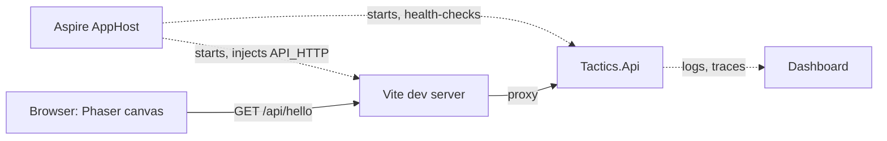

# Step 00 — Project setup & tooling

**In one sentence:** one command (`aspire run`) now starts the API and the browser client, and a Phaser canvas shows the game title plus a message fetched from the API.

## What we built
- A .NET solution with 4 app projects and 2 test projects: `Tactics.slnx`.
- Shared build rules and one place for package versions: `Directory.Build.props`, `Directory.Packages.props`, `global.json`.
- A Minimal API with `GET /api/hello`: `src/Tactics.Api/Program.cs`.
- An Aspire AppHost that runs the API and the Vite dev server together: `src/Tactics.AppHost/AppHost.cs`.
- A Vite + TypeScript + Phaser 4 client with one scene: `client/src/main.ts`, `client/src/scenes/BootScene.ts`.
- Smoke tests: `tests/Tactics.Core.Tests`, `tests/Tactics.Api.Tests`, `client/src/**/*.test.ts`.

**Repo map: what lives where, and why**
- `src/Tactics.Core`: the rules (empty for now). It's pure and BCL-only, so it's testable and replayable.
- `src/Tactics.Api`: the referee's front desk (HTTP now; SignalR and storage later). It asks Core for every decision.
- `src/Tactics.ServiceDefaults`: telemetry, health checks and resilience, shared by every service.
- `src/Tactics.AppHost`: dev-only orchestration. It never ships.
- `client/`: the view. It draws and animates, but never decides a rule.
- `content/` holds game data you edit, `docs/` your notes, `.claude/skills/` the Phaser 4 API guides.

## New game-dev ideas
- **Framework vs engine** — Phaser is a library you call from code: renderer, scenes, input, tweens, loader. Unity and Godot are editors that host your code. *Like in .NET/Angular:* Phaser ≈ ASP.NET Core, where you write `Program.cs` yourself, not a designer tool.
- **Scene and its lifecycle** — a scene is one screen of the game. Phaser calls `init → preload → create`, then `update` every frame. *Like in .NET/Angular:* a routed component; `create()` ≈ `ngOnInit`.
- **Game loop** — Phaser redraws the whole canvas about 60 times a second, even when nothing changed. *Like in .NET/Angular:* not change detection (event-driven). Closer to a `while (true)` loop in a `BackgroundService`.
- **WebGL vs Canvas** — WebGL draws on the GPU with shaders: fast, and Phaser 4's main renderer. Canvas 2D draws on the CPU: simpler, now deprecated. *Like in .NET/Angular:* hardware vs software rendering.
- **Base resolution + scale mode** — we always draw in 960×640. `Scale.FIT` stretches the canvas to the window and keeps 3:2, with bars on the sides. *Like in .NET/Angular:* an SVG `viewBox`.

## Main functions
- `AddProject<Projects.Tactics_Api>("api").WithHttpHealthCheck(...)` — `src/Tactics.AppHost/AppHost.cs` — declares the API as a resource · Aspire starts it, picks ports, watches `/health`.
- `AddViteApp("client", "../../client").WithReference(api).WaitFor(api)` — same file — runs `npm install`, then `npm run dev` · injects `API_HTTP`, so no URL is hard-coded.
- `AddServiceDefaults()` — `src/Tactics.ServiceDefaults/Extensions.cs` — OpenTelemetry, health checks, resilience · logs and traces show up in the dashboard.
- `api.MapGet("/hello", ...)` — `src/Tactics.Api/Program.cs` — returns `HelloResponse` · the smallest proof that the API answers.
- `server.proxy["/api"]` — `client/vite.config.ts` — forwards `/api/*` to `API_HTTP` · the browser sees one origin, so no CORS.
- `new Phaser.Game({...})` — `client/src/main.ts` — boots the renderer, the scale manager and the game loop · every Phaser game starts here.
- `BootScene.create()` — `client/src/scenes/BootScene.ts` — draws the title and a status text · our first lifecycle hook.
- `fetchHelloMessage(fetchFn)` — `client/src/net/hello.ts` — fetches and validates `/api/hello`, with a 5 s timeout · kept outside Phaser so Vitest can test it.

## How the logic flows
1. You run `aspire run` at the repo root. The CLI finds `src/Tactics.AppHost` and starts it.
2. The AppHost opens the dashboard and starts the `api` resource (like `dotnet run`).
3. Aspire polls `/health` on the API's http endpoint. Once it's Healthy, `WaitFor(api)` releases the client.
4. `client-installer` runs `npm install`. Then Vite starts with `--port` and the `API_HTTP` / `API_HTTPS` variables.
5. You open the client URL. Vite serves `index.html` and transpiles `src/main.ts` on the fly.
6. `main.ts` sets `document.title`, then creates the `Phaser.Game`, which starts `BootScene`.
7. `BootScene.create()` draws the texts and calls `fetchHelloMessage()`, which sends `GET /api/hello` to the Vite origin.
8. Vite's proxy forwards the request to the API. The JSON comes back, and `status.setText(message)` updates the canvas.

## See it yourself
- Once: `aspire certs trust` (Windows asks you to confirm). The dashboard then opens without a certificate warning.
- Run: `aspire run` at the repo root · Open: the dashboard link printed in the terminal · You should see: `api` and `client` **Running** and **Healthy**.
- Click the `client` URL. You should see a black canvas centred in the window, "Tactics Duel" and "API is alive" in white, and the title in the tab.
- Resize the window: the canvas scales and keeps 3:2.
- In the dashboard, stop `api` and reload the client page. After about 5 s you'll see "API unreachable: …".

## Try it yourself (10–15 min)
- Change `GAME_TITLE` → the page reloads by itself, and both the canvas and the tab show the new title.
- Add an `update(time: number)` method to `BootScene`. Store the status text in a field and set its `alpha` to `0.5 + 0.5 * Math.sin(time / 300)` → the text pulses: the game loop at work.
- Change `"API is alive"` in `Program.cs`, then run `dotnet test` → the smoke test fails, so you see it guarding the contract. Revert it.
- Hint: open `client/src/scenes/BootScene.ts` and `.claude/skills/scenes/SKILL.md` (see `update(time, delta)`).

## Your creative hooks
- The game's name: `GAME_TITLE` in `client/src/config.ts`. It's the only place in code.
- The base resolution: `GAME_WIDTH` / `GAME_HEIGHT` in the same file. Decide before Step 6 lays out the board.

## Words to know
- **Vite** — dev server + bundler for the client (≈ `ng serve` + the Angular build).
- **HMR** — Vite updates the running page when a file changes, without a manual reload.
- **Dev proxy** — Vite forwards `/api` to the API, so the browser only talks to one origin.
- **Aspire** — a C# AppHost that runs your services, plus a dashboard and injected URLs (≈ docker-compose + a dashboard + service discovery).
- **Resource** — one thing Aspire runs (here `api`, `client` and `client-installer`).
- **Central Package Management** — NuGet versions live once in `Directory.Packages.props` (≈ one shared `package.json` versions block).
- **Microsoft.Testing.Platform** — the new .NET test runner; `global.json` opts `dotnet test` into it.
- **Origin** — an object's anchor point. `setOrigin(0.5)` centres it on its x/y.

## Watch out
- Most Phaser code online is Phaser 3. Check `.claude/skills/v3-to-v4-migration/SKILL.md` before copying it.
- `dotnet add package X` without a version may pick 11.x. Put versions in `Directory.Packages.props`, with ASP.NET Core and EF Core on 10.0.x.
- Warnings are errors in every project, so an unused variable breaks the build. That's on purpose.
- The Core purity test only sees assemblies that Core's code *uses*. A package reference that nothing uses won't trip it.
