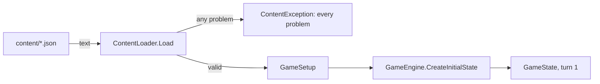

# Step 01 — Game state model (C#)

**In one sentence:** the whole game (board, units, stats, whose turn) now exists as immutable C# data, loaded and validated from two JSON files you can edit.

## What we built
- Records that describe a game at one moment: `src/Tactics.Core/Model/` (`Position`, `Unit`, `UnitType`, `Board`, `GameState`…).
- A loader that turns your JSON into a validated setup and lists every mistake at once: `src/Tactics.Core/Content/ContentLoader.cs`.
- The game data, with the placeholder values: `content/units.json`, `content/scenarios/classic.json`.
- One shared JSON setup (camelCase, enums as strings): `src/Tactics.Core/Serialization/TacticsJson.cs`.
- The engine's first function, `CreateInitialState`: `src/Tactics.Core/GameEngine.cs`.
- A helper that turns a board picture into a state: `tests/Tactics.Core.Tests/Helpers/AsciiBoard.cs`. 69 Core tests in all.

## New game-dev ideas
- **Game state vs what's drawn** — `GameState` is the truth: tiles, HP, whose turn. The canvas (Step 6) is only a picture of it. *Like in .NET/Angular:* a store or ViewModel vs the DOM; you change the model, the view follows.
- **Immutable state** — rules never edit a state; `with` makes a changed copy. Every past state stays valid, so undo, replays and safe tests come almost free. *Like in .NET/Angular:* an NgRx reducer that returns a new state object.
- **Grid coordinates** — origin top-left, x grows right, y grows **down**, like pixels. So "up" is `Y - 1`. On a 4-way grid, distance is Manhattan: `|dx| + |dy|`. *Like in .NET/Angular:* CSS `top`/`left`.
- **Data-driven design** — stats and layouts live in JSON; code only knows the rules. You rebalance without recompiling. *Like in .NET/Angular:* `appsettings.json` instead of hard-coded constants.
- **A pure core with zero dependencies** — Core takes JSON *text* and returns data. No files, clock, randomness or NuGet packages, so the same inputs always give the same game. *Like in .NET/Angular:* a domain layer with no infrastructure references.

## Main functions
- `RealContent.UnitsJson` — `tests/Tactics.Core.Tests/Helpers/RealContent.cs` — reads your files · the I/O stays outside Core.
- `ContentLoader.Load(unitsJson, scenarioJson)` — `src/Tactics.Core/Content/ContentLoader.cs` — parse, validate, build a `GameSetup` · one door for all game data.
- `Parse<T>()` — same file — JSON text → file DTOs, all fields nullable · so "missing" can be told apart from 0. Syntax errors get a line and a column.
- `ReadUnitTypes()` / `ReadScenario()` — same file — check every rule, collect `ContentError`s · you see all your mistakes in one run.
- `ContentException` — `src/Tactics.Core/Content/ContentException.cs` — carries every error · the server must never start a broken game.
- `GameEngine.CreateInitialState(setup)` — `src/Tactics.Core/GameEngine.cs` — turn 1, Player One, full HP · the engine's first pure function.
- `UnitAt` / `FindUnit` / `TypeOf` / `UnitsOf` — `src/Tactics.Core/Model/GameState.cs` — the questions every rule asks · keeps rules short.
- `Position.Neighbors()` — `src/Tactics.Core/Model/Position.cs` — up, right, down, left, always in that order · Step 2's BFS needs a fixed order to stay deterministic.
- `AsciiBoard.Parse(map)` — `tests/Tactics.Core.Tests/Helpers/AsciiBoard.cs` — picture → `GameState` with fixed test stats · rule tests read like the board.

## How the logic flows
1. A test (from Step 5, also the API at startup) reads `units.json` and `classic.json` as text.
2. `ContentLoader.Load` deserializes both into file DTOs with `TacticsJson.Options`.
3. It checks every field and collects each problem as a `ContentError(Code, Message)`.
4. Any problem → one `ContentException` listing them all. Otherwise it builds `UnitType`s, the `Board` and the `UnitPlacement`s into a `GameSetup`.
5. `GameEngine.CreateInitialState(setup)` turns each placement into a full-HP `Unit`: the first `GameState`.
6. From Step 2, `GameEngine.Apply(state, action)` returns the *next* state. From Step 6, the client draws it.



## See it yourself
- Run: `dotnet test --project tests/Tactics.Core.Tests` · You should see: 69 tests passed.
- Open `content/units.json` and `content/scenarios/classic.json`: that's the whole game data, and the tests prove it loads.
- Open `tests/Tactics.Core.Tests/Helpers/Maps.cs`: the same classic board, as a picture.

## Try it yourself (10–15 min)
1. **Break a stat.** In `content/units.json`, set the Mage's `"maxHp"` to `0`, then run `dotnet test --project tests/Tactics.Core.Tests`.
   - You should see 2 failures saying `Units file: unit type "mage": "maxHp" must be at least 1 (it is 0).`
   - Put `14` back.
2. **Rebalance.** Set the Archer's `"maxRange"` to `4` and run the tests: all 69 pass. Tests check validity, not your numbers. Keep it or revert.
3. **Write a board test.** At the end of the class in `tests/Tactics.Core.Tests/Model/GameStateTests.cs`, add:
   ```csharp
   [Fact]
   public void My_first_board_test()
   {
       var state = AsciiBoard.Parse("""
           . m
           A #
           """);
       Assert.Equal("one-archer", state.UnitAt(new Position(0, 1))?.Id);
   }
   ```
   - Run the tests: 70 pass. Change `(0, 1)` to `(1, 1)`: it fails with `Actual: null`, because that tile is the obstacle.
   - An `ArgumentException` about cells or rows? Put a space between cells (`A #`, not `A#`).
   - `Unknown symbol`? Only `W A M H`, `w a m h`, `#` and `.` are allowed.

## Your creative hooks
- `content/units.json`: stats, and new unit types (one line each). The field rules are in `content/README.md`.
- `content/scenarios/classic.json`: board size, obstacles, starting positions. `dotnet test` tells you if an edit broke something.

## Words to know
- **Record** — a C# type with value equality and `with`; our default for game data.
- **`with` expression** — copies a record with some properties changed.
- **Immutable collections** — `ImmutableList`, `ImmutableDictionary`: "adding" returns a new collection.
- **DTO** — a type shaped like the JSON file; validated, then mapped to domain records.
- **Source of truth** — `GameState`. Everything else (screen, API views) is derived from it.
- **Deterministic** — same inputs, same game. Replays need it (Step 4).
- **Test fixture** — fixed data a test starts from, like `AsciiBoard.DefaultUnitTypes`.

## Watch out
- Y grows **down**, so "up" is `Y - 1`. It's easy to flip.
- A record that holds collections compares them **by reference**: two identical-looking `GameState`s aren't equal. Compare the `Units` lists instead, or JSON (Step 4).
- While `aspire run` is running, `dotnet build` at the root fails with "file is locked" (MSB3027). Stop it, or build just the project you changed.
- Rule tests use `AsciiBoard.DefaultUnitTypes`, not `content/units.json`, on purpose. Don't "fix" that.
