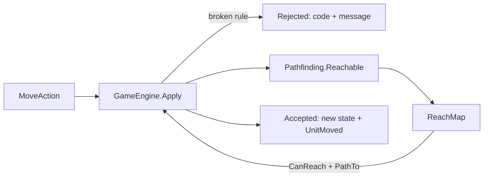

# Step 02 — Movement & pathfinding (C#)

**In one sentence:** a unit can now move: the engine checks the move, finds its path, and returns the new state plus a `UnitMoved` event.

## What we built
- A search that finds every reachable tile and the shortest path to each: `src/Tactics.Core/Rules/Pathfinding.cs`, `Rules/ReachMap.cs`.
- Moves as data: `MoveAction` in `src/Tactics.Core/Actions/GameAction.cs`.
- Facts about what happened: `UnitMoved` in `src/Tactics.Core/Events/GameEvent.cs`.
- `GameEngine.Apply` and its move rules: `src/Tactics.Core/GameEngine.cs`, `GameEngine.Move.cs`.
- Its answer, `ActionOutcome.Accepted` or `ActionOutcome.Rejected` with a `RuleViolation` code: `ActionOutcome.cs`, `RuleViolation.cs`.
- `AsciiBoard.Draw`, which prints a board with step counts, so a test compares a whole picture: `tests/Tactics.Core.Tests/Helpers/AsciiBoard.cs`. 120 Core tests in all.

## New game-dev ideas
- **Manhattan vs walking distance** — Manhattan (`|dx| + |dy|`) is the distance on an empty board. Walls and units make the real walk longer. *Like in .NET/Angular:* straight-line distance vs the route a maps app finds.
- **BFS flood fill** — a queue explores tiles ring by ring: every tile 1 step away, then 2, then 3. The first visit to a tile is always by a shortest path. *Like in .NET/Angular:* walking a folder tree level by level.
- **Came-from map** — each tile remembers the tile it was reached from. Walk back from the destination and reverse: that's the path. *Like in .NET/Angular:* following `Parent` links up a tree.
- **Command pattern** — a move is data (`MoveAction`), not a method call. It can be checked, logged, sent over HTTP and replayed. *Like in .NET/Angular:* a CQRS command or a MediatR request.
- **Validate, then apply** — every check runs before anything changes. A broken rule returns `Rejected` instead of throwing. *Like in .NET/Angular:* `ModelState` errors for bad input, not exceptions.
- **Events as "what happened"** — `UnitMoved` is a past-tense fact, with the path. The client will animate it, then trust the state. *Like in .NET/Angular:* a domain event raised after a save.

BFS distances from the classic warrior (`W`, Move 3), straight from the test `The_classic_warrior_reaches_17_tiles`:
```
     x: 0 1 2 3 4 5 6 7
y=0     . h . m . . a .
y=1     . . . . w . . .
y=2     . . . . . # . .
y=3     . . # 3 . . . .
y=4     . . 3 2 3 # . .
y=5     . 3 # 1 2 3 . .
y=6     3 2 1 W 1 2 3 .
y=7     . A 2 1 M 3 H .
```
- Each number is the steps from `W`. Obstacles, units and the bottom edge cut the 24-tile diamond down to 17.
- Behind a wall the two distances split: in `Obstacles_block_so_the_path_goes_around_them`, (2, 0) is 2 tiles away by Manhattan, but 6 on foot.

## Main functions
- `GameEngine.Apply(state, action)` — `src/Tactics.Core/GameEngine.cs` — rejects if the game is over or it's not your turn, then picks the rules by action type · one door for every action.
- `ApplyMove(state, move)` — `src/Tactics.Core/GameEngine.Move.cs` — unit exists → it's yours → hasn't acted → hasn't moved → reachable · a fixed order gives each mistake one code.
- `Pathfinding.Reachable(state, unit)` — `src/Tactics.Core/Rules/Pathfinding.cs` — BFS up to `Move` steps · geometry only, so Step 4 can reuse it for "available moves".
- `IsWalkable(board, occupied, tile)` — same file — on the board, not an obstacle, no unit · the one place that says what blocks a unit.
- `ReachMap.CanReach(tile)` — `src/Tactics.Core/Rules/ReachMap.cs` — is this tile a destination? · the start tile never is.
- `ReachMap.PathTo(tile)` — same file — follows the came-from entries back, then reverses · the path the client will animate.
- `WhyNotReachable(...)` — `GameEngine.Move.cs` — explains a refusal: `"(5, 2) is an obstacle."` · codes are for programs, messages for people.
- `new ActionOutcome.Accepted(next, [UnitMoved])` — `src/Tactics.Core/ActionOutcome.cs` — the new state plus the event · state for truth, events for animation.
- `AsciiBoard.Draw(state, reach)` — `tests/Tactics.Core.Tests/Helpers/AsciiBoard.cs` — the board with step counts · one picture checks every tile and path.

## How the logic flows
1. Something builds a command: `new MoveAction(PlayerSide.One, "one-archer", new Position(1, 5))`. Today a test; from Step 5, the API.
2. `GameEngine.Apply` checks that the game isn't over and that it's this player's turn.
3. `ApplyMove` finds the unit, then checks its owner and its `HasActed` / `HasMoved` flags.
4. `Pathfinding.Reachable` runs the BFS. If `CanReach(to)` is false → `Rejected(DestinationNotReachable, …)`.
5. Apply: `unit with { Position = to, HasMoved = true }`, then `state with { Units = … }`. The old state is untouched.
6. `Accepted(newState, [UnitMoved])` goes back. From Step 8, the client animates the `Path`, then snaps to the state.



## See it yourself
- Run: `dotnet test --project tests/Tactics.Core.Tests` · You should see: 120 tests passed.
- Open `tests/Tactics.Core.Tests/Rules/PathfindingTests.cs`: each picture is a BFS result. Start with `On_an_open_board_the_reach_is_a_diamond`.
- Open `tests/Tactics.Core.Tests/GameEngineMoveTests.cs`: one test per rejection code, then a sweep over every tile.
- Nothing on screen yet: the browser starts showing moves in Step 7.

## Try it yourself (10–15 min)
1. **Swap two directions.** In `src/Tactics.Core/Model/Position.cs`, swap the `up` and `right` lines in `Neighbors()`. Run `dotnet test --project tests/Tactics.Core.Tests`.
   - Exactly 3 tests fail: `Neighbors_come_in_the_fixed_order_up_right_down_left`, `Destinations_come_nearest_first`, `Ties_between_equally_short_paths_follow_the_neighbor_order`.
   - Every picture still passes. The order changes *which* shortest path wins, never the step counts.
   - Swap the lines back.
2. **Predict a BFS picture.** In `PathfindingTests.cs`, copy `Obstacles_block_so_the_path_goes_around_them` and rename the copy, e.g. `My_maze`.
   - In the first picture, draw your board: one `W` (it moves 3) and some `#`.
   - In the expected picture, write the steps by hand, ring by ring: `1` next to `W`, `2` next to each `1`, then `3`.
   - Delete the comment and the last two asserts (`ManhattanTo`, `CanReach`): they're about the original board.
   - Run the tests. If yours fails, xUnit prints both texts (rows joined by `\n`) with an arrow at the first difference.
   - Compile error CS8999 ("Line does not start with the same whitespace…")? Indent every picture line at least as far as the closing `"""`.
   - `ArgumentException` about a row or a cell? Put one space between cells, and give every row the same width.
   - Added other units and the numbers look wrong? `state.Units[0]` is the first unit in reading order; use `state.FindUnit("one-warrior")!`.

## Your creative hooks
- `IsWalkable` in `src/Tactics.Core/Rules/Pathfinding.cs`: what blocks a unit. Walking *through* allies starts here.
- `Position.Neighbors()` in `src/Tactics.Core/Model/Position.cs`: add the 4 diagonals for 8-way movement.
- Terrain costs (a forest costs 2 steps) need Dijkstra: a BFS with a priority queue. It's in the backlog.
- The refusal messages in `src/Tactics.Core/GameEngine.Move.cs`: the words players read.
- `move` in `content/units.json`: the real game's movement range. Rule tests keep their fixed stats.

## Words to know
- **BFS (breadth-first search)** — explores ring by ring with a queue; finds shortest paths when every step costs 1.
- **Flood fill** — spreading from one tile to every connected tile, like paint.
- **Frontier** — the queue of tiles found but not explored yet.
- **Came-from map** — for each reached tile, the tile the search came from.
- **Path reconstruction** — following the came-from entries back from the destination, then reversing.
- **Command** — a request stored as data (`MoveAction`).
- **Event** — a past-tense fact (`UnitMoved`), for animation and logs.
- **Rule violation** — a stable code for a refusal (`NotYourTurn`).
- **Closed hierarchy** — a base type with a fixed set of subtypes (`Accepted` or `Rejected`).
- **Type discriminator** — the JSON field (`"type": "move"`) that names the subtype.

## Watch out
- Records compare lists **by reference**. Two identical-looking `UnitMoved` events aren't `Equal`: each has its own `Path` list. Compare fields or JSON (see `ActionEventJsonTests`).
- The JSON `"type"` field only appears when you serialize as the base type (`GameAction`, `GameEvent`). Serialize a `MoveAction` variable and it's gone.
- Picture tests need `ignoreLineEndingDifferences: true`: on a Windows checkout, Git turns the raw strings' line endings into `\r\n`.
