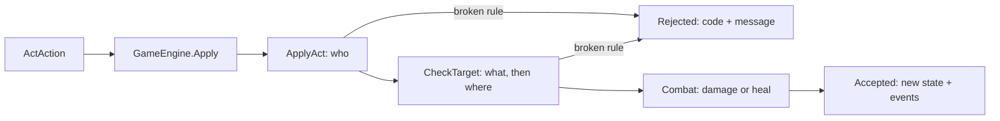

# Step 03 — Attack & heal (C#)

**In one sentence:** units can now hit enemies and heal injured allies in range, and a unit that drops to 0 HP leaves the board.

## What we built
- The combat formulas and nothing else: `CalculateDamage` and `CalculateHeal` in `src/Tactics.Core/Rules/Combat.cs`.
- A second command, `ActAction` ("this unit acts on that one"), in `src/Tactics.Core/Actions/GameAction.cs`.
- Three events, `UnitDamaged`, `UnitHealed` and `UnitDefeated`, in `src/Tactics.Core/Events/GameEvent.cs`.
- The rules for acting: `ApplyAct` and `CheckTarget` in `src/Tactics.Core/GameEngine.Act.cs`, plus the codes `TargetNotFound`, `InvalidTarget` and `TargetOutOfRange` in `RuleViolation.cs`.
- Tests: `CombatTests` (the damage table) and `GameEngineActTests`, plus `state.WithUnit(...)` to set up injured units. 177 Core tests in all.

## New game-dev ideas
- **Targeting rules** — who may act on whom: damage hits enemies, and a heal helps injured allies. *Like in .NET/Angular:* an authorization policy that runs before the handler.
- **Range band and blind spot** — a target must be `MinRange` to `MaxRange` tiles away (Manhattan distance). The Archer's 2–3 leaves a blind spot next to it, a weakness built in on purpose. *Like in .NET/Angular:* `[Range(2, 3)]` on a model property.
- **Deterministic formulas** — `max(1, power − defense)`, with no dice. The floor of 1 means no defense makes a unit invulnerable. HP is **clamped**: it never goes below 0 or above MaxHp. *Like in .NET/Angular:* `Math.Clamp`, and a pure pricing function (same cart, same total).
- **Overkill and event ordering** — a killing blow can be bigger than the HP left. `Amount` keeps the full hit, and `HpAfter` stops at 0. Then `UnitDefeated` follows: cause before effect, the order the client will animate. *Like in .NET/Angular:* domain events published in the order they happened.
- **One place for balance** — the formulas live in `Combat.cs` and the numbers in `content/units.json`. A damage table shows the whole balance at a glance. *Like in .NET/Angular:* settings in `appsettings.json` instead of magic numbers.
- **The server computes damage** — a client never sends "I did 50 damage", only "the archer acts on the warrior". The engine does the math, so a cheating client can ask but never decide. *Like in .NET/Angular:* the server recomputes an order's total; it never trusts a price from the browser.

The damage table for the placeholder stats, straight from `CombatTests`:
```
                 vs Warrior (def 3)   Archer (def 1)   Mage (def 0)   Healer (def 1)
Warrior (power 10)        7                 9              10               9
Archer  (power 8)         5                 7               8               7
Mage    (power 12)        9                11              12              11
```
- An Archer needs 6 hits to defeat a Warrior (28 HP at 5 a hit), but only 2 for a Mage (14 HP at 8).
- The Healer has no row: it heals 5, capped at the HP its target is missing.

## Main functions
- `GameEngine.Apply(state, action)` — `src/Tactics.Core/GameEngine.cs` — the shared checks (game over, whose turn), then the `ActAction` case · one door for every action.
- `ApplyAct(state, act)` — `src/Tactics.Core/GameEngine.Act.cs` — the actor exists → it's yours → it hasn't acted · the same "who" checks as a move; having moved is fine.
- `CheckTarget(actor, actorType, target, targetType)` — same file — wrong kind → `InvalidTarget`, wrong distance → `TargetOutOfRange`, otherwise `null` · Step 4 reuses it, so highlights and `Apply` always agree.
- `Combat.CalculateDamage(attackerType, targetType)` — `src/Tactics.Core/Rules/Combat.cs` — `max(1, power − defense)` · the balance formula, on stats only.
- `Combat.CalculateHeal(healerType, targetType, targetHp)` — same file — `min(power, maxHp − hp)` · the cap is part of the formula.
- `Hit(...)` — `GameEngine.Act.cs` — stops HP at 0; at 0 it removes the unit and adds `UnitDefeated` · applying the hit is the engine's job, not the formula's.
- `Heal(...)` — same file — adds the capped amount and emits `UnitHealed`.
- `WhyOutOfRange(type, distance)` — same file — "Archer hits targets 2–3 tiles away; this target is 1 tile away." · codes for programs, words for people.
- `state.WithUnit(id, change)` — `tests/Tactics.Core.Tests/Helpers/GameStateExtensions.cs` — an injured unit in one line, e.g. `u => u with { Hp = 3 }`.

## How the logic flows
1. A command arrives: `new ActAction(PlayerSide.One, "one-archer", "two-warrior")`. Today it comes from a test; from Step 5, from the API.
2. `Apply` checks that the game isn't over and that it's this player's turn, then calls `ApplyAct`.
3. `ApplyAct` checks the actor: it exists, it's yours, and it hasn't acted.
4. Then the target: it exists, then `CheckTarget` checks the kind (what), then the distance (where).
5. Apply: the actor gets `HasActed` and `HasMoved`, then `Hit` or `Heal` runs, depending on its `Ability`.
6. `Hit` asks `Combat` for the damage and stops HP at 0. At 0 it removes the unit, and the events are `[UnitDamaged, UnitDefeated]`.
7. `Accepted(newState, events)` goes back. From Step 8, the client animates the hit, then the defeat.



## See it yourself
- Run: `dotnet test --project tests/Tactics.Core.Tests` · You should see: 177 tests passed.
- Open `tests/Tactics.Core.Tests/Rules/CombatTests.cs`. The table at the top is the whole damage balance.
- Break a number. In `src/Tactics.Core/Rules/Combat.cs`, change `Math.Max(1, …)` to `Math.Max(0, …)`, then run the tests.
  - Exactly 2 tests fail: both cases of `Damage_is_at_least_1_even_against_a_higher_defense`.
  - The damage table still passes, because with these stats power always beats defense. Put the `1` back.
- Nothing shows in the browser yet: attacks appear in Step 7 and get animations in Step 8.

## Try it yourself (10–15 min)
**Gang up on a warrior:** three of your units hit one enemy in the same turn.
1. In `tests/Tactics.Core.Tests/GameEngineActTests.cs`, add a `[Fact]` named `Three_units_gang_up_on_a_warrior`. Use this board: the archer is 2 tiles from the enemy warrior `w`, and your warrior and mage stand next to it.
   ```
   A . w W
   . . M a
   ```
2. Chain three acts. Each `Apply` takes the previous state:
   `var s1 = Assert.IsType<ActionOutcome.Accepted>(GameEngine.Apply(state, new ActAction(PlayerSide.One, "one-archer", "two-warrior"))).State;`
   Then build `s2` from `s1` with `"one-warrior"`, and `s3` from `s2` with `"one-mage"`.
3. Predict the HP before you run: 28 − 5 − 7 − 9, from the table. Then write `Assert.Equal(<your number>, s3.FindUnit("two-warrior")!.Hp);`.
4. Bonus: add `.WithUnit("two-warrior", u => u with { Hp = 9 })` after `Parse`. Which act defeats it? The third act is now refused, so replace the `s3` line and the HP assert with:
   `Assert.Equal(RuleViolation.TargetNotFound, Assert.IsType<ActionOutcome.Rejected>(GameEngine.Apply(s2, new ActAction(PlayerSide.One, "one-mage", "two-warrior"))).Code);`
- Compile error CS0128 ("A local variable named … is already defined")? Give each state its own name: `s1`, `s2`, `s3`.
- `Assert.IsType() Failure … Rejected`? An act was refused. To see why, store the result in `var outcome = GameEngine.Apply(...)`, then temporarily write `Assert.Fail(outcome.ToString());`. A record prints its fields: `Rejected { Code = TargetOutOfRange, Message = … }`.
- Wrong HP? Recheck the table row: the attacker's power minus the warrior's defense of 3.

## Your creative hooks
- `src/Tactics.Core/Rules/Combat.cs`: the formulas. Ideas: percentage defense, bonuses against some types, counter-attacks. Critical hits need seeded randomness first (backlog).
- `content/units.json`: `power`, `defense`, `minRange`, `maxRange` and `ability` tune the game with no code. Rule tests keep fixed stats, so they stay green.
- `CheckTarget` in `src/Tactics.Core/GameEngine.Act.cs`: who may target whom (friendly fire, line of sight later).
- Healers healing themselves: allow `minRange: 0` in `ContentLoader`. The engine already copes (`A_unit_with_MinRange_0_can_heal_itself`).
- New abilities (push, buff): a new `Ability` value, a case in `CheckTarget`, and a case in `ApplyAct`'s switch.

## Words to know
- **Targeting rules** — who may act on whom.
- **Range band** — the distances from `MinRange` to `MaxRange` where a target is valid.
- **Blind spot** — the tiles closer than `MinRange`; the unit can't target anything there.
- **Damage floor** — the smallest damage a hit can do (here 1).
- **Clamp** — keeping a value inside limits, such as HP between 0 and MaxHp.
- **Overkill** — the part of a hit beyond the HP the target had left.
- **Damage table** — the damage of every attacker against every target, in one grid.
- **Game balance** — tuning numbers and formulas so that no choice is always the best one.
- **Authoritative server** — the server decides every outcome; clients only ask.
- **Mutation test** — breaking code on purpose to check that a test notices.

## Watch out
- `Amount` isn't always the HP lost: on a killing blow, it's the full hit. Draw HP bars from `HpAfter`.
- A record is a snapshot. After `state.Units.Replace(actor, …)`, the old `actor` copy is no longer in the list, so `ApplyAct` reads the target again. Otherwise a unit acting on itself would crash `Replace`.
- Defeating the last enemy doesn't end the game yet: victory comes in Step 4. Test boards keep a unit on each side, so Step 4 won't change their events.
