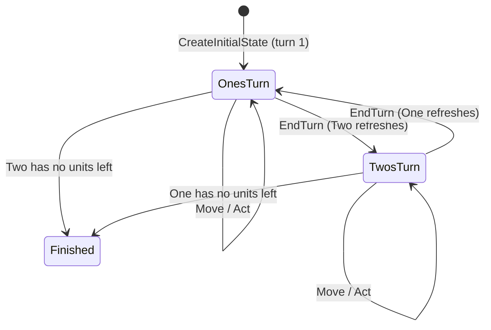

# Step 04 — Turns, victory & replay (C#)

**In one sentence:** a whole game now plays in pure C#: turns alternate, the last side with units wins, and any game can be rebuilt from its list of actions.

## What we built
- A third command, `EndTurnAction`, and two events, `TurnEnded` and `GameWon`, in `src/Tactics.Core/Actions/GameAction.cs` and `src/Tactics.Core/Events/GameEvent.cs`.
- The turn rules in `src/Tactics.Core/GameEngine.Turn.cs`, and the win condition on its own in `src/Tactics.Core/Rules/Victory.cs`.
- `GameEngine.GetAvailableActions`: what each unit can still do, for the client to highlight (`GameEngine.AvailableActions.cs`, `UnitActions.cs`).
- `GameEngine.Replay`: setup + action log → state, with `ReplayException` when a log doesn't replay (`GameEngine.Replay.cs`).
- Tests: a whole game told as a story (`ScriptedGameTests`), a brute-force check that highlights match `Apply`, and a JSON round trip for every action and event. 223 Core tests in all.

## New game-dev ideas
- **Turn state machine** — the game is always in one state: One's turn, Two's turn, or finished. `EndTurn` switches sides and **refreshes** the next side's units: their move and act come back. *Like in .NET/Angular:* an order workflow (Pending → Paid → Shipped) where only some commands change the status.
- **Win condition and terminal state** — `Victory.WinnerOf` runs after every accepted action. `Finished` is terminal: no action leaves it, so everything gets `GameOver`. *Like in .NET/Angular:* a cancelled order that refuses every further command.
- **Legal move generation** — the engine lists every legal option; chess engines call this "move generation". It reuses `Reachable` and `CheckTarget`, so a highlight is always a move `Apply` accepts. *Like in .NET/Angular:* HATEOAS links: the server says what you may do next.
- **Determinism and replay** — no `Random`, no `DateTime.Now`, and a fixed order (lists, never hash sets), so the same actions always give the same game. A state is then a **fold** over the actions. RTS games rely on this for replay files and **lockstep** online play. *Like in .NET/Angular:* an NgRx reducer, `actions.reduce(reducer, initialState)`.
- **Event sourcing lite** — the server will store the setup and the actions, never the state, and rebuild it with `Replay`. Strictly, that's **command sourcing**: we re-run requests through the rules, where event sourcing re-applies events. *Like in .NET/Angular:* EF Core migrations: the schema is every migration, run in order.
- **Record equality and JSON contracts** — a record compares its lists by reference, so two identical states aren't `Equal`; tests compare their JSON (`StateJson`). Each JSON shape is pinned, and a **guard test** fails if a new type isn't registered. *Like in .NET/Angular:* snapshot tests, or a contract test between two services.

## Main functions
- `GameEngine.Apply(state, action)` — `src/Tactics.Core/GameEngine.cs` — shared checks, the action's own rules, then `FinishIfWon` · one door, and a last step no rule can forget.
- `ApplyEndTurn(state)` — `src/Tactics.Core/GameEngine.Turn.cs` — refreshes the next side, switches `CurrentPlayer`, adds 1 to `TurnNumber`, emits `TurnEnded` · nothing to check beyond whose turn it is.
- `FinishIfWon(accepted)` — `GameEngine.cs` — asks `Victory`; on a winner: `Finished`, `Winner`, and `GameWon` added last · the rule decides, the engine applies.
- `Victory.WinnerOf(state)` — `src/Tactics.Core/Rules/Victory.cs` — a side with no units left loses; both still fighting → `null` · the one place for win conditions.
- `GameEngine.GetAvailableActions(state, side)` — `GameEngine.AvailableActions.cs` — `MoveTargets` and `ActTargets` for each unit that can still do something · the client highlights, never computes.
- `GameEngine.Replay(setup, actions)` — `GameEngine.Replay.cs` — `CreateInitialState`, then `Apply` on each action; a rejection throws `ReplayException(Sequence, Action, Code)` · the server stores actions only.
- `Playthrough.Play(action)` — `tests/Tactics.Core.Tests/Helpers/Playthrough.cs` — plays, fails the test on a rejection, keeps the log · a test then reads like a game.
- `StateJson.AssertSame(expected, actual)` — `tests/Tactics.Core.Tests/Helpers/StateJson.cs` — compares two states as JSON · `Equals` can't do it for records with lists.

## How the logic flows
1. Player One is done: `new EndTurnAction(PlayerSide.One)`.
2. `Apply` checks that the game is on and that it's One's turn, then calls `ApplyEndTurn`.
3. `ApplyEndTurn` refreshes Two's units, hands the turn to Two (turn 2) and emits `TurnEnded(One, Two, 2)`.
4. The last step of `Apply`, `FinishIfWon`, asks `Victory.WinnerOf`. Both sides have units, so nothing more happens.
5. Turns later, an arrow defeats Two's last unit. Now `WinnerOf` says One: the game is `Finished`, and `GameWon` comes right after `UnitDefeated`.
6. From then on, the very first check in `Apply` answers `GameOver`.
7. Any time later, `Replay(setup, log)` runs steps 2–5 again for each logged action and lands on the same state.

## See it yourself
- Run: `dotnet test --project tests/Tactics.Core.Tests` · You should see: 223 tests passed.
- Read `tests/Tactics.Core.Tests/ScriptedGameTests.cs` top to bottom: a whole game with no UI. Run it alone: `dotnet test --project tests/Tactics.Core.Tests --filter-class "*ScriptedGameTests"` → 1 test passed.
- Break the refresh. In `src/Tactics.Core/GameEngine.Turn.cs`, change `HasActed = false` to `HasActed = u.HasActed`, then run the tests.
  - Exactly 3 fail: two in `GameEngineTurnTests`, and the story.
  - The story stops on turn 3: `Expected: TargetOutOfRange`, `Actual: AlreadyActed`. The archer still counts as "acted" from turn 1. Put `false` back.
- Nothing new in the browser yet: Step 5 puts this engine behind an HTTP API.

## Try it yourself (10–15 min)
**Undo for free:** rebuild a game without its last action.
1. In `tests/Tactics.Core.Tests/GameEngineReplayTests.cs`, add a `[Fact]` named `Undo_is_a_replay_without_the_last_action`. Put it inside the class, so it can call the private `PlayTwoTurns()`.
2. Replay everything but the last action:
   `var game = PlayTwoTurns();`
   `var undone = GameEngine.Replay(game.Setup, game.Log.SkipLast(1));`
3. The last action was Player Two's `EndTurnAction`. Predict whose turn it is in `undone`, and which turn number. Then assert both, e.g. `Assert.Equal(PlayerSide.Two, undone.CurrentPlayer);`.
4. Bonus: `SkipLast(3)` undoes Player Two's whole turn. Check that `two-archer` stands on `new Position(1, 0)` again and that `one-warrior` has 28 HP.
- CS0103 "The name 'PlayTwoTurns' does not exist in the current context"? Your test sits after the class's closing `}`. Move it inside.
- `ReplayException` with `Sequence` 4? You wrote `Skip` instead of `SkipLast`. `Skip(1)` drops the *first* action: the warrior never moves, and Player Two's arrow is then out of range. A log only works whole and in order.

## Your creative hooks
- `src/Tactics.Core/Rules/Victory.cs`: new win conditions, such as holding a tile, surviving until turn N, or a draw when both sides fall at once. It runs after every action and can read `TurnNumber`.
- `ApplyEndTurn` in `src/Tactics.Core/GameEngine.Turn.cs`: what a new turn brings, e.g. units that waited heal a little, or poison ticks.
- `src/Tactics.Core/GameEngine.AvailableActions.cs`: a "danger zone" preview (the tiles enemies could hit next turn), built from `Reachable` and `CheckTarget`.
- `GameEngine.Replay` with `log.SkipLast(n)`: undo in local mode, a replay viewer, "show me the last turn".

## Words to know
- **Turn state machine** — the game's states (whose turn, finished) and the actions that move between them.
- **Refresh** — giving a side's units their move and act back when its turn starts.
- **Win condition** — the rule that decides when the game ends and who won.
- **Terminal state** — a state no action can leave (`Finished`).
- **Legal move generation** — listing every action a side may take right now.
- **Fold** — combining a list into one value step by step (`Aggregate`, `reduce`).
- **Lockstep** — online play where machines swap only inputs, and each runs the same deterministic game.
- **Replay** — rebuilding a game by running its action log again from the setup.
- **Command sourcing** — storing the requests (actions) and rebuilding the state by re-running them. Event sourcing stores the events instead.
- **Contract test** — a test that pins a JSON shape character for character.
- **Guard test** — fails when a new case is added in one place but not in another that must list it.
- **Brute-force test** — tries every possible input and checks one property for each.

## Watch out
- Replays use **today's** rules. Change `Combat.cs`, and a stored game can replay differently, or a once-legal action gets rejected and `Replay` throws. Real games tie a replay to the game version. It matters once games are stored (Step 12).
- `Assert.Equal(stateA, stateB)` fails even for the same game: records compare `ImmutableList` by reference. Use `StateJson.AssertSame`, on states from the same setup.
- Give every test board units on both sides. Otherwise the first accepted action, even an `EndTurn`, also ends the game with `GameWon`.
