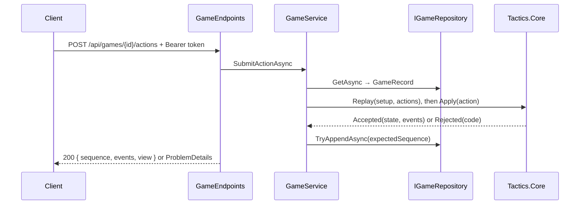

# Step 05 — Game server v1 (in-memory API)

**In one sentence:** two players can now create, join and play a whole game over HTTP, and `Tactics.Core` judges every action on the server.

## What we built
- Four endpoints: create, join, get your view, play an action (`src/Tactics.Api/Http/GameEndpoints.cs`).
- `GameService`, the referee's desk: load the game, check the token and the sequence, `Replay`, `Apply`, store (`src/Tactics.Api/Games/GameService.cs`).
- A store that keeps games in memory, with one lock per game: `InMemoryGameRepository`, behind `IGameRepository`. Step 12 adds PostgreSQL behind the same interface.
- Tokens and invite codes instead of accounts: `PlayerSecrets` (random, hashed, compared in constant time).
- The wire contract: DTOs plus one mapping class in `src/Tactics.Api/Contracts/`, mirrored in `client/src/game/types.ts`.
- OpenAPI and Scalar (Development only), plus 74 new API tests (300 .NET tests in all).

## New game-dev ideas
- **Authoritative server** — the server decides every outcome; the client only asks. A client that decided could teleport units, hit for 999 or play the other side's turn. *Like in .NET/Angular:* you validate on the server, whatever the Angular form already checked.
- **No tick loop** — a real-time game server runs a loop many times a second (each run is a **tick**). A turn-based game changes only when someone acts, so one HTTP request per action is enough. *Like in .NET/Angular:* a CRUD API vs a `BackgroundService` on a timer.
- **Optimistic concurrency** — each action says which state it was made from (`expectedSequence`). If another action got in first, the answer is 409 and the client refreshes. Nothing stays locked while a player thinks. *Like in .NET/Angular:* EF Core's `rowversion` and `DbUpdateConcurrencyException`.
- **DTOs and per-player views** — Core records are the rules' language and DTOs are the wire contract; `ContractMapping` is the only bridge, so the rules can change without breaking clients. Each player also gets their own view: `yourSide`, and `availableActions` only for the side that plays. Fog of war would plug in there. *Like in .NET/Angular:* API models vs EF entities, and a view model built per user.
- **Capability tokens** — whoever holds a seat's token plays that seat: no account, no password. The server keeps only a SHA-256 hash, so a leaked store lets nobody play. *Like in .NET/Angular:* a password-reset link or an Azure SAS URL.
- **Content snapshot** — each game keeps the setup it was created with, and the view's `unitTypes` come from it. Rebalancing `content/` changes new games only, and a stored game replays with its own stats (Step 12). *Like in .NET/Angular:* an order line stores the price at purchase time, not a link to today's price.

## Main functions
- `SetupProvider.LoadFrom(contentDirectory)` — `src/Tactics.Api/Games/SetupProvider.cs` — reads and validates `content/` once, at startup · broken content stops the API and lists every problem.
- `GameService.CreateGameAsync()` — `GameService.cs` — a new `GameRecord`: setup snapshot, token hash, invite code, empty log · the token is returned once, and only its hash is kept.
- `GameService.JoinGameAsync(gameId, inviteCode)` — `GameService.cs` — the code (403), then a free seat (409), then `TryJoinAsync` · an invite works once.
- `GameService.SubmitActionAsync(gameId, token, expectedSequence, action)` — `GameService.cs` — 404 → 401 → 409 → 422 → store · the referee's flow, in a fixed order.
- `ActionDto.ToCore(side)` — `src/Tactics.Api/Contracts/ContractMapping.cs` — builds the Core action with the side from the token · why a client can't play the other side.
- `InMemoryGameRepository.TryAppendAsync(gameId, expectedSequence, action, at)` — `InMemoryGameRepository.cs` — appends only if the log still has `expectedSequence` actions, under the game's lock · compare-and-swap; in Step 12, a primary key does the same job.
- `GameRecord.ToView(state, side)` — `ContractMapping.cs` — the per-player view, with `GetAvailableActions` for that side · exactly what the client draws.
- `ApiProblems.From(error)` — `src/Tactics.Api/Http/ApiProblems.cs` — PLAN.md's HTTP error table as one switch · clients branch on `status` and `code`.
- `PlayerSecrets.Matches(token, storedHash)` — `PlayerSecrets.cs` — SHA-256, then a constant-time comparison · response times leak nothing.

## How the logic flows
1. Player One posts `{ "expectedSequence": 0, "action": { "type": "move", … } }` with `Authorization: Bearer <token>`.
2. `GameEndpoints.SubmitAction` binds the JSON (`ContractJson` turns a malformed body into a 400) and reads the token with `BearerToken.Read`.
3. `SubmitActionAsync` loads the `GameRecord` (404 if it doesn't exist), then finds the side whose hash matches the token (401 if none does).
4. It compares `expectedSequence` with the log's length (409 if they differ), then rebuilds the state: `GameEngine.Replay(setup, actions)`.
5. `ToCore(side)` builds the Core action, and `GameEngine.Apply` judges it (422 with Core's code if it's rejected).
6. `TryAppendAsync` stores it as action 1, unless another request got there first (409).
7. The answer is `{ sequence, events, view }`. From Step 7, the client animates the events, then snaps to the view.

## See it yourself
- Run: `aspire run` · Open: the dashboard, then the **Scalar (API docs)** link next to the `api` resource.
  1. `POST /api/games` → copy `gameId`, `playerToken` and `inviteCode`.
  2. `POST /api/games/{gameId}/join` with `{ "inviteCode": "…" }` → a second `playerToken`.
  3. Paste Player One's token in Scalar's auth field (`playerToken`). `GET /api/games/{gameId}` → 4 units have `availableActions`.
  4. `POST /api/games/{gameId}/actions` with `{ "expectedSequence": 0, "action": { "type": "move", "unitId": "one-archer", "to": { "x": 1, "y": 6 } } }` → 200, a `unitMoved` event, `sequence` 1.
  5. Send it again → 409 `SequenceConflict`. Switch to Player Two's token and send `{ "expectedSequence": 1, "action": { "type": "endTurn" } }` → 422 `NotYourTurn`.
- A whole game: `dotnet test --project tests/Tactics.Api.Tests --filter-class "*FullGameTests"` → 1 passed. Read `FullGameTests.cs` top to bottom.
- In the dashboard, open **Structured logs**: you should see `Game … action 1 accepted: MoveAction { … }`. No token or invite code appears there.

## Try it yourself (10–15 min)
**Let Player One see the invite code again**, while seat two is free (useful after a page refresh in Step 10). One change in the contract touches four places, and a check flags each one.
1. In `src/Tactics.Api/Contracts/GameView.cs`, add a last parameter to `GameView`: `string? InviteCode`.
   - `dotnet build` → `CS7036: There is no argument given that corresponds to the required parameter 'InviteCode'` in `ContractMapping.cs`. That's step 2.
2. In `ContractMapping.ToView`, add a last argument: `InviteCode: side == PlayerSide.One && !game.HasPlayerTwo ? game.InviteCode : null`.
3. Run `dotnet test --project tests/Tactics.Api.Tests` → exactly 1 failure, `The_waiting_player_s_view_has_the_contract_shape`. Player Two's view now ends with `"inviteCode":null`. Add `"inviteCode": null` after `"availableActions": []` in the expected JSON (with a comma).
4. In `client/src/game/types.ts`, add `inviteCode: string | null;` to `GameView`. Then `npm run typecheck` → `TS2741: Property 'inviteCode' is missing` in `types.test.ts`: add `inviteCode: null` to the sample `view`.
- Bonus: in `LobbyTests`, check that `created.View.InviteCode` equals `created.InviteCode`, and that Player One's view after the join has `null`.

## Your creative hooks
- `InviteCodeAlphabet` and `InviteCodeLength` in `src/Tactics.Api/Games/PlayerSecrets.cs`: the invite code's look. Shorter codes are easier to type, and easier to guess.
- The messages at the bottom of `GameService.cs` and the titles in `ApiProblems.cs`: the words players read when a request is refused. Clients use `code`, so the wording is yours.
- `SetupProvider.DefaultScenarioId`: the scenario new games use. A scenario choice later means loading more files and adding a `scenarioId` to `POST /api/games`.
- `ContractMapping.ToView`: what each player is allowed to see. Fog of war would filter `units` there, while the rules still see everything.

## Words to know
- **Tick** — one run of a real-time server's update loop, often 20 to 60 per second.
- **Optimistic concurrency** — no lock while the user thinks; the write checks that nothing changed since the read.
- **Sequence number** — how many actions have been played; a request sends the one it saw as `expectedSequence`.
- **Compare-and-swap** — "write only if the value is still the one I expect", checked and written in one step.
- **Capability token** — a secret that grants a right by itself, with no account behind it.
- **Bearer token** — a token sent as `Authorization: Bearer <token>`; whoever holds ("bears") it is trusted.
- **Constant-time comparison** — compares secrets in a time that doesn't depend on where they differ.
- **ProblemDetails** — the standard JSON error body (RFC 9457): `type`, `title`, `status`, `detail`, plus extensions like `code`.
- **Wire contract** — the JSON shapes that client and server agree on.
- **Per-player view** — the game as one player may see it.
- **Setup snapshot** — the setup a game was created with, kept with the game.
- **OpenAPI / Scalar** — a machine-readable description of an HTTP API / a web page that reads it and calls the API.
- **Test host** — the real app running in memory for tests (`WebApplicationFactory`).

## Watch out
- Games live in memory: stopping `aspire run` loses them all. Step 12 adds the database.
- `content/` is read once, at startup. After editing it, restart `aspire run`; running games keep their old stats anyway (snapshot).
- In Development, error pages echo your request, `Authorization` header included. Don't paste them anywhere public. Production errors stay plain (`ProductionErrorTests`).
- A `playerToken` is shown only once. Lose it and that seat is lost (Step 10 stores it in the browser).
