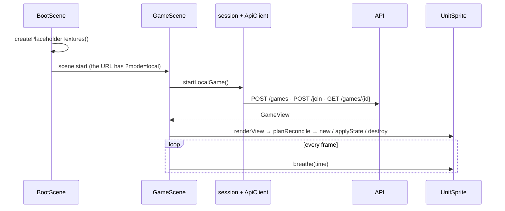

# Step 06 — Phaser 101: draw the board

**In one sentence:** `/?mode=local` now starts a real game on the server, and the browser draws its board, obstacles and units, with HP bars, from the server's `GameView`.

## What we built
- A typed HTTP client and a local "pass & play" session (two players, one screen): `client/src/net/ApiClient.ts`, `client/src/net/session.ts`.
- `GameScene`, which draws any `GameView` and keeps the sprites in sync by unit id: `client/src/scenes/GameScene.ts`. An empty `HudScene` runs on top of it.
- The board, drawn once (`client/src/game/BoardRenderer.ts`), and one `UnitSprite` per unit: body, letter, HP bar (`client/src/game/UnitSprite.ts`).
- Every placeholder visual in one file: debug colours, sizes, generated textures (`client/src/media/placeholder.ts`).
- Pure, tested maths: tiles ↔ pixels (`game/grid.ts`), the reconcile plan (`game/reconcile.ts`), HP bar and breathing (`game/unitDisplay.ts`).
- Dev-only console commands (`tactics.move(...)` and co.) to play before Step 7 adds clicks: `client/src/game/debugCommands.ts`. 38 client tests in all.

## New game-dev ideas
- **Game loop and delta time** — every frame (about 60 a second), Phaser calls `update(time, delta)`, then redraws everything. `delta` is the time since the last frame. Compute motion from `time`, or multiply each per-frame step by `delta`. Otherwise a 144 Hz screen plays 2.4× faster than a 60 Hz one. *Like in .NET/Angular:* not change detection, which waits for events. It's a `while (true)` render loop with a `Stopwatch`.
- **Scenes in parallel** — `GameScene` launches `HudScene`, and both run at once. Scenes draw in the config's order, so the HUD is always on top, with its own camera. *Like in .NET/Angular:* two router outlets on one page, the second one an overlay.
- **Game objects, display list and depth** — a scene draws its display list every frame. A **Container** groups objects so they move as one; its children are placed relative to it. `depth` decides what's in front: tiles 0, highlights 10, units 20, effects 30. *Like in .NET/Angular:* the DOM, a `position: relative` div, and CSS `z-index`.
- **Textures vs images, and tint** — a texture is pixels kept on the GPU. An Image shows one, with its own position, scale and tint. All 8 units share one white circle texture; **tint** multiplies it into blue or red. *Like in .NET/Angular:* one image file, many `` tags, each with its own CSS.
- **Grid space vs world space** — the server speaks tiles, `(3, 6)`; the screen speaks pixels, `(448, 480)`. `tileToWorld` and `worldToTile` convert: scale by the tile size, then add the board's origin. The origin is computed, so any board size is centred. *Like in .NET/Angular:* turning a click's `offsetX` into a table cell.
- **Render from state (reconcile)** — the screen never edits itself. Each new view is matched to the sprites by unit id: a new id is created, a known id is updated, a missing id is destroyed. *Like in .NET/Angular:* `*ngFor` with `trackBy`.

## Main functions
- `BootScene.create()` — `client/src/scenes/BootScene.ts` — bakes the textures, then starts `GameScene` if the URL has `?mode=local` · the URL picks the screen, like a route.
- `createPlaceholderTextures(scene)` — `client/src/media/placeholder.ts` — draws each shape with Graphics, then calls `generateTexture` · drawn once, shown by many Images.
- `startLocalGame(api)` — `client/src/net/session.ts` — create → join with the invite code → get the view as the player to move · one browser holds both seats.
- `ApiClient.getView(gameId, token)` — `client/src/net/ApiClient.ts` — a GET with `Authorization: Bearer`; refusals become an `ApiError` with the server's `code` · the only file that knows URLs and headers.
- `GameScene.renderView(view)` — `client/src/scenes/GameScene.ts` — draws the board once, then reconciles the units · the screen always matches the last view.
- `planReconcile(existingIds, units)` — `client/src/game/reconcile.ts` — lists the sprites to create, update and destroy · pure, so Vitest checks it.
- `tileToWorld(layout, tile)` — `client/src/game/grid.ts` — a tile's centre, in pixels · the one place where tiles become pixels.
- `UnitSprite.applyState(unit)` — `client/src/game/UnitSprite.ts` — moves the sprite to its tile and sizes the HP bar · shows the server's numbers, decides nothing.
- `GameScene.update(time, delta)` → `UnitSprite.breathe(time)` — every frame, scales each body by `breathingScale(time)` · the game loop at work.
- `GameScene.submit(action)` — `GameScene.ts` — posts with the current player's token and `view.sequence`, then draws the answer · Step 7's clicks will call it.

## How the logic flows
1. You open `/?mode=local`. `BootScene.create()` bakes the textures, then reads the URL.
2. `this.scene.start(GameScene.KEY)` is queued. At the next frame, Boot stops and `GameScene` runs `init`, then `create`.
3. `create()` launches `HudScene` and calls `startLocalGame`: three requests, through the Vite proxy.
4. The view arrives. `renderView` builds the `BoardRenderer` (64 tile images), and `planReconcile` says "create 8".
5. Each `new UnitSprite` places itself with `tileToWorld` and sizes its HP bar with `hpFraction`.
6. Every frame, `update(time)` makes the bodies breathe. Nothing else changes until a new view comes in.
7. In the console, `tactics.act(...)` calls `submit`. The server sends a new view, and `renderView` updates or destroys sprites.



## See it yourself
- Run: `aspire run` · Open: the dashboard → the `client` URL, then add `/?mode=local` to the address.
- You should see: the 8×8 board centred, 4 dark obstacles, blue W A M H at the bottom, red ones at the top, full HP bars, and a slow breathing.
- Press F12 → Console. Type these one at a time; each answer prints below:
  ```js
  tactics.units()                        // turn 1, player one to move, and a table of the units
  tactics.move("one-warrior", 0, 0)      // "Not played (DestinationNotReachable)": the server refuses
  tactics.move("one-mage", 4, 5)
  tactics.endTurn()
  tactics.move("two-mage", 3, 2)
  tactics.endTurn()
  tactics.move("one-mage", 4, 3)
  tactics.act("one-mage", "two-mage")    // the red mage's bar drops to 2/14
  tactics.move("one-warrior", 3, 3)
  tactics.act("one-warrior", "two-mage") // the red mage disappears
  ```
- Reload the page → a brand-new game. Open plain `/` → the boot screen, with a hint.

## Try it yourself (10–15 min)
**All units breathe in unison, which looks mechanical. Give each its own rhythm.**
1. In `client/src/game/unitDisplay.ts`, give `breathingScale` a second parameter, `phase = 0` (a fraction of a breath), and add it: `const breaths = timeMs / BREATH_PERIOD_MS + phase;`.
2. In `client/src/game/UnitSprite.ts`, add a field `private readonly breathPhase: number;`. In the constructor, below `super(scene)`, set it from the starting tile: `this.breathPhase = ((unit.x * 3 + unit.y * 5) % 8) / 8;`.
   - TS2564 "has no initializer and is not definitely assigned": the field is declared but never set in the constructor.
   - TS17009 "'super' must be called before accessing 'this'": move your line below `super(scene)`.
3. In `breathe(time)`, pass it on: `breathingScale(time, this.breathPhase)`.
4. In `client/`, run `npm test`: still green, because `phase` defaults to 0. Bonus: test that `breathingScale(0, 0.25)` is close to `1 + BREATH_AMOUNT`.
- You should see: the units pulse out of step, like a crowd.
- One-line extra: set `TILE_SIZE` to 48 in `client/src/config.ts` → everything shrinks and stays centred.

## Your creative hooks
- `client/src/media/placeholder.ts`: the whole look today (colours, sizes, shapes, letters). Step 9 swaps it for your art.
- The `UnitSprite` constructor and `applyState`: what a unit shows. Ideas: dim the units that already acted (`hasActed`), HP as numbers, a shadow.
- `breathingScale`, `BREATH_PERIOD_MS` and `BREATH_AMOUNT` in `client/src/game/unitDisplay.ts`: the idle animation (speed, size, or a bob instead).
- `TILE_SIZE` and `PIXEL_ART` in `client/src/config.ts`: decide them together with your art style.
- `layoutBoard` in `client/src/game/grid.ts`: where the board sits. Centred today; shift it to leave room for a side panel.

## Words to know
- **Display list** — the ordered list of game objects a scene draws every frame.
- **Game object** — anything a scene can show: an Image, a Text, a Rectangle, a Container.
- **Container** — a game object that holds others and moves, scales or fades them as one.
- **Depth** — the drawing order: a higher depth is drawn in front, like CSS `z-index`.
- **Texture** — image data kept on the GPU, which any number of game objects can show.
- **Generated texture** — a texture drawn in code (`generateTexture`) instead of loaded from a file.
- **Tint** — a colour multiplied into a texture's pixels as it's drawn.
- **Delta time** — the milliseconds since the previous frame.
- **Frame-rate independent** — looks the same at any FPS, because it's computed from time, not counted in frames.
- **Grid space / world space** — tile coordinates / pixel coordinates.
- **Reconcile** — make the screen match a new state, matching items by id.
- **HUD** — the heads-up display drawn over the game: turn, panels, buttons.
- **Pass and play** — two players sharing one screen and taking turns.
- **Idle animation** — a small loop that keeps units looking alive while they wait.

## Watch out
- Reloading starts a new game: the tokens live only in memory until Step 10. The old game stays on the server until it restarts.
- In a Phaser game object subclass, don't name fields `body`, `type`, `state`, `data`, `name`, `depth`… Phaser already uses them. TypeScript refuses some; a field of the same type silently hides Phaser's own.
- A bigger scenario can overflow the screen: 12 rows of 64 px is 768 px, and the screen is 640. Lower `TILE_SIZE`, or wait for camera scrolling.
