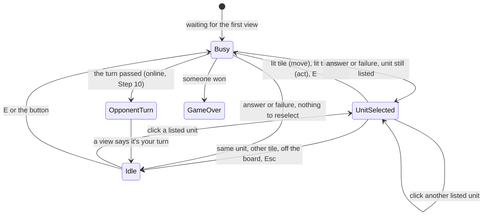

# Step 07 — Input: select, move, act, end turn

**In one sentence:** you can now play a whole local game with the mouse and keyboard, from the first click to "Player One wins!", and the server still judges every action.

## What we built
- The input state machine: five states, one pure `transition` function and 43 tests, in `client/src/game/InputController.ts`.
- Highlights read from the server's lists: `client/src/game/highlights.ts` decides what lights up, and `BoardRenderer.showHighlights` / `showHover` draw it.
- One action's round trip, with the 409 resync and the pass-and-play seat switch: `client/src/net/play.ts`, plus `viewToShow` in `client/src/net/session.ts`.
- Temporary on-canvas controls (status line, End Turn button, message line) in `client/src/game/TurnControls.ts`. Step 8 moves them into the HUD.
- `GameScene` connects the pointer and keyboard to the machine, and the console commands use the same path (`client/src/scenes/GameScene.ts`). 106 client tests in all.

## New game-dev ideas
- **Pointer input on a canvas** — the canvas is one DOM element, with no buttons inside for the browser to find. Phaser re-emits the canvas's events in game pixels, and `worldToTile` finds the tile. Phaser hit-tests only objects marked with `setInteractive()`, like the End Turn button. *Like in .NET/Angular:* one `(click)` handler on a `<canvas>` that reads `offsetX`.
- **The input state machine** — a click means different things in different states. The same empty tile moves a unit, deselects it, or is ignored while busy. Five named states replace a set of booleans that could contradict each other. *Like in .NET/Angular:* an NgRx reducer `(state, event) → state`, or a C# `switch` over a closed set of records.
- **Busy: locking input** — between the request and its answer, the machine ignores every click and key, so a double click can't send twice. *Like in .NET/Angular:* disabling a submit button until the HTTP call returns.
- **Thin client: ask, don't compute** — every highlight comes from `view.availableActions`. The client computes no range and no path, so it can't disagree with the server. *Like in .NET/Angular:* a dropdown whose options come from the API, not from a copy of the backend's rules.
- **Conflicts and resync** — a 409 means "you decided on an old view". The client doesn't retry the action: it fetches the game again, shows it, and the player decides again. *Like in .NET/Angular:* catching EF Core's `DbUpdateConcurrencyException`, then reloading the entity.
- **Game timers** — the message line clears itself through `this.time.delayedCall`, which runs on the scene's clock. It pauses with the scene and dies with it, while a `setTimeout` would fire into a stopped scene. *Like in .NET/Angular:* `takeUntilDestroyed`, not a global timer.

## Main functions
- `GameScene.listenToPlayer()` — `client/src/scenes/GameScene.ts` — listens to `pointerdown`, `pointermove`, `gameout`, `keydown-ESC` and `keydown-E` · the canvas's only way in.
- `GameScene.tileUnder(pointer)` → `worldToTile(layout, worldX, worldY)` — `GameScene.ts`, `client/src/game/grid.ts` — the tile under the pointer, or null off the board · pixels back to tiles.
- `GameScene.handle(event)` — `GameScene.ts` — runs `transition`, keeps the new state, redraws, sends the request · the only place `inputState` changes.
- `transition(state, event, view)` — `client/src/game/InputController.ts` — returns the next state and the action to send, or null · the whole machine, pure.
- `highlightsFor(state, view)` — `client/src/game/highlights.ts` — the selected tile, the move tiles, the target tiles · all from `availableActions`.
- `BoardRenderer.showHighlights(list)` / `showHover(tile)` — `client/src/game/BoardRenderer.ts` — draws them at depths 10 and 11 · above the tiles, below the units.
- `playAction(api, session, view, action)` — `client/src/net/play.ts` — POSTs with `expectedSequence` and returns a `PlayOutcome` (accepted, rejected or resynced) · never throws.
- `viewToShow(api, session, view)` — `client/src/net/session.ts` — after End Turn, GETs the view of the player to move · the server answers with the sender's view.
- `GameScene.showOutcome(outcome)` — `GameScene.ts` — draws the new view and sends `viewReceived`, or sends `requestFailed`, then shows any message · this is how busy ends.
- `TurnControls.showMessage(text)` — `client/src/game/TurnControls.ts` — shows a message for 4 seconds · a game timer.

## How the logic flows
1. The archer is selected, and you click a light tile. The browser sends `pointerdown` to the canvas, and Phaser converts it to game pixels.
2. `tileUnder` turns `pointer.worldX/worldY` into tile `(1, 6)`.
3. `handle` calls `transition`. `(1, 6)` is in the archer's `moveTargets`, so the state becomes `busy` and the request is a `move`.
4. `renderInput` clears the highlights and dims the End Turn button. `play(request)` starts.
5. `playAction` POSTs `{ expectedSequence, action }` with the current player's token, and the server judges it.
6. On a 200, if the turn changed, `viewToShow` first GETs the next player's view.
7. `showOutcome` calls `renderView` (the sprite jumps), then `viewReceived`. The archer stays selected if it can still shoot; otherwise the state is back to idle.

## See it yourself
- Run: `aspire run` · Open: the `client` URL + `/?mode=local`.
- You should see:
  - "Turn 1 · Player One to play" above the board, "[ End turn (E) ]" on the right, and a white outline that follows the mouse.
  - Click the blue A. Its tile turns cyan, the tiles it can reach turn light, and enemies in range turn yellow.
  - Click a light tile: the archer jumps there (Step 8 animates it). Then press `E`: "Turn 2 · Player Two to play", and the red units answer clicks.
  - Play both sides until one wins. The line says "Player One wins!" (or Two), and clicks do nothing.
- To watch a refusal, open F12 → Console and run `tactics.move("one-warrior", 0, 0)`. The server's sentence shows under the board for 4 seconds.

## Try it yourself (10–15 min)
**Make a right-click deselect, like `Esc`.**
1. In `client/src/scenes/GameScene.ts`, find `listenToPlayer()`. At the top of the `POINTER_DOWN` listener, add:
   `if (pointer.rightButtonDown()) { this.handle({ type: "cancelled" }); return; }`
2. A right-click also opens the browser's menu. Turn it off with this line at the start of `listenToPlayer()`: `this.input.mouse?.disableContextMenu();`
   - TS2531 "Object is possibly 'null'": you left out the `?.`. Like `keyboard`, `mouse` is null when the game config turns it off.
3. In `client/`, run `npm run typecheck`, then reload the page.
- You should see: select a unit, right-click anywhere, and the highlights go away with no menu.
- Bonus: in `clickTile` (`client/src/game/InputController.ts`), make a plain tile keep the selection. Change the last `stay({ kind: "idle" })` to `stay(state)`, then run `npm test`. The tests that fail document the old rule.

## Your creative hooks
- `transition` and `clickTile` in `client/src/game/InputController.ts`: what a click means. Ideas: click an enemy to inspect it, or confirm End Turn while units can still act.
- `listenToPlayer` in `client/src/scenes/GameScene.ts`: the controls. Ideas: Tab to cycle your units, right-click to cancel.
- `HIGHLIGHT_LOOK` and the highlight colours in `client/src/media/placeholder.ts`: how options look. `highlightsFor` decides which tiles light up.
- `statusLine` in `client/src/game/turnText.ts`, and `OUT_OF_DATE_MESSAGE` in `client/src/net/play.ts`: the words players read.
- `MESSAGE_DURATION_MS` in `client/src/game/TurnControls.ts`: how long a message stays (it moves to `feel.ts` in Step 8).

## Words to know
- **Input state machine** — the client's input states and what each click or key does in each one.
- **Transition** — one step of a state machine: in a given state, an event leads to the next state.
- **Busy state** — waiting for the server (from Step 8, for an animation too), with input ignored.
- **Pointer** — Phaser's single object for mouse, touch and pen input.
- **Hit test** — finding which object is under the pointer.
- **Interactive object** — a game object that Phaser hit-tests, after `setInteractive()`.
- **Event propagation** — an input event travelling from the object under the pointer to the whole scene.
- **Screen space** — the pointer on the canvas (`pointer.x`), before the camera. World space comes through it (`pointer.worldX`).
- **Highlight / hover** — a lit tile that shows an option / the marker on the tile under the pointer.
- **Thin client** — shows the state and asks the server, but decides nothing.
- **Resync** — after a 409, fetching the game again instead of resending the action.
- **Key repeat** — the repeated `keydown` events a held key sends, with `event.repeat` true.
- **Game timer** — a call scheduled on the scene's clock (`this.time.delayedCall`).

## Watch out
- A held key repeats `keydown`. Without the `event.repeat` check, holding `E` would also end the next player's turn. Phaser filters repeats only for keys made with `addKey`.
- Use `pointer.worldX`, not `pointer.x`, for anything on the board. They're equal only while the camera stays still, and Step 8's shake moves it.
- A click on an interactive object also reaches the scene's `pointerdown`, after the object's own handler. That's why the End Turn button calls `event.stopPropagation()`: otherwise the same click would also deselect.
