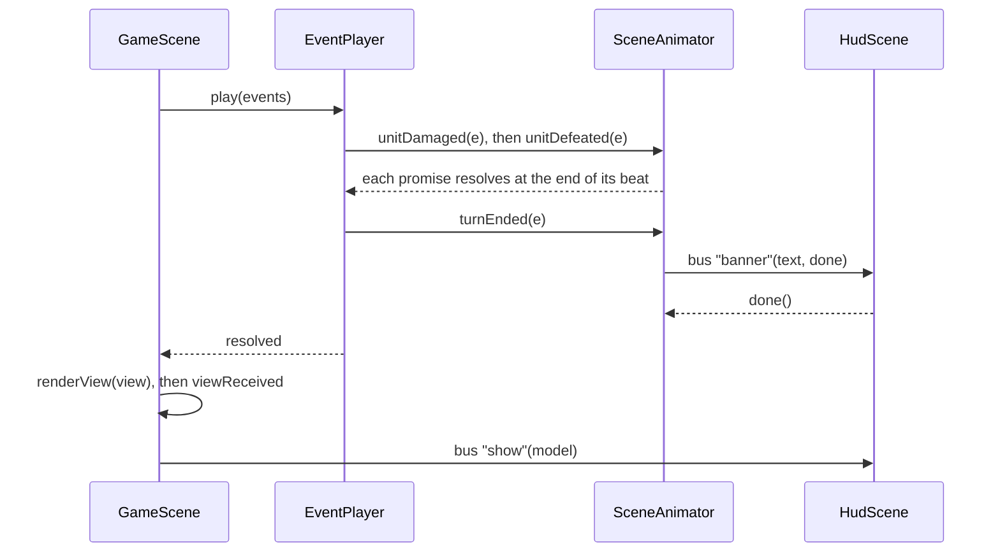

# Step 08 — Game feel: animations & HUD

**In one sentence:** the game now shows what happens (units walk, hits lunge and flash, numbers rise, the fallen fade, banners announce turns and the winner), and a HUD scene on top shows the turn, the selected unit and End Turn.

## What we built
- The event player: an `Animator` interface, a queue, and 8 tests with a fake animator, in `client/src/game/EventPlayer.ts`.
- The Phaser animator: walk, lunge, flash, floating numbers, shake, fade, in `client/src/game/SceneAnimator.ts` and new methods of `client/src/game/UnitSprite.ts`.
- `client/src/game/feel.ts`: every duration, easing curve and shake strength, in one table of *placeholder* values.
- The HUD: `client/src/scenes/HudScene.ts`, with its parts in the new `client/src/hud/` folder (panel, banner, victory overlay, messages).
- A typed event bus between the scenes (`client/src/game/EventBus.ts`, `client/src/hud/hudEvents.ts`) and a pure, tested HUD model (`client/src/hud/hudModel.ts`). 142 client tests in all.

## New game-dev ideas
- **Tweens and easing** — a tween (an in-between animation) moves one property from A to B over time; Phaser computes each frame's value. The easing curve sets the speed along the way: `easeOut` starts fast and settles, like a throw. *Like in .NET/Angular:* a CSS transition with `cubic-bezier`, or Angular's `animate('300ms ease-out')`.
- **Sequencing async animations** — each animation is a Promise. `await` in a loop plays events one by one; `Promise.all` plays the parts of one hit together. An event's beat ends once everything the snap redraws is done (position, HP bar, fade); numbers and the shake may linger. *Like in .NET/Angular:* awaiting tasks in a `foreach` vs `Task.WhenAll`, or RxJS `concatMap` vs `merge`.
- **Events for animation, state for truth** — an answer brings events (what happened) and a view (where we are). We animate the events, then snap every sprite to the view. A skipped or wrong animation fixes itself at the snap. *Like in .NET/Angular:* an optimistic UI that finally re-reads the server's response.
- **Scene layering** — the HUD is a second scene, drawn on top, with its own camera: the shake moves the board, not the HUD. It gets input first, so a click on its button never reaches the board. *Like in .NET/Angular:* a sibling component in its own layer, talking through a shared service.
- **Locking input during animation** — the input stays `busy` from the click until the animation has played and the view is on screen. Clicks and keys in between do nothing. *Like in .NET/Angular:* a form disabled until the HTTP call *and* its success animation end.
- **Juice** — small, exaggerated reactions (a lunge, a white flash, a shake, a number) that make an action read clearly and feel heavy. They change no rule, and all tune in `feel.ts`. *Like in .NET/Angular:* UX micro-interactions, such as Material's ripple on a button.

## Main functions
- `GameScene.play(action)` — `client/src/scenes/GameScene.ts` — sends, shows the outcome, then tells the state machine · input stays busy all along.
- `GameScene.showOutcome(outcome)` — same file — animation first, then `renderView`, then `viewReceived` · that order *is* the input lock.
- `EventPlayer.play(events)` — `client/src/game/EventPlayer.ts` — one event at a time, batches queued, failures skipped · resolves when it's time to snap.
- `SceneAnimator.unitDamaged(event)` — `client/src/game/SceneAnimator.ts` — lunge out, then flash + HP drain + number + shake + lunge back together · one hit's beat.
- `UnitSprite.walk(path)` — `client/src/game/UnitSprite.ts` — one tween per tile, in a chain · the unit turns corners.
- `tween(scene, config)` — `client/src/game/tweens.ts` — Phaser's `onComplete` callback as a Promise · so animations can be awaited.
- `UnitSprite.applyState(unit)` — `UnitSprite.ts` — stops leftover tweens, then sets tile, HP, alpha, scale and tint · the snap always wins.
- `hudModelFor(view, input, viewer)` — `client/src/hud/hudModel.ts` — turn line, End Turn enabled, the selected unit's card · render from state, for the HUD.
- `EventBus.emit(name, ...args)` — `client/src/game/EventBus.ts` — a typed message to every listener · the scenes never import each other.

## How the logic flows
1. You click a lit enemy. `transition` returns an `act` request, and the state `busy`.
2. `play` POSTs it. The server answers with events (`unitDamaged`, `unitDefeated`) and a view.
3. `showOutcome` calls `EventPlayer.play(events)`. `SceneAnimator` lunges, flashes and shakes, then fades the defeated unit.
4. `renderView` snaps every sprite to the view, and destroys the defeated unit's sprite.
5. `viewReceived` ends `busy`. `renderHud` sends the HUD a fresh model on the bus.
6. After End Turn, `turnEnded` makes `SceneAnimator` ask the HUD for its banner, and wait for `done`.

## See it yourself
- Run: `aspire run` · Open: the `client` URL + `/?mode=local`.
- You should see:
  - "Turn 1 · Player One to play" at the top, with a blue square. Click the blue A: its card appears on the left.
  - Click a light tile: the archer walks there, tile by tile. Press `E` and click around while it walks: nothing happens.
  - Attack: the attacker lunges, the target flashes white, a "−N" rises, the board shakes a little, the HP bar drains.
  - Defeat a unit: it swells for an instant, then fades and shrinks away.
  - Press `E`: a "Player Two's turn" banner crosses the screen, then the top line changes.
  - Win: the screen dims under "Player One wins!" (or Two).
- Slow motion: set `speed: 0.25` in `client/src/game/feel.ts`, save (the page reloads), and play a hit.

## Try it yourself (10–15 min)
**Inspect any unit: with nothing selected, the card shows the unit under the pointer.**
1. In `client/src/hud/hudModel.ts`, give `hudModelFor` a 4th parameter with a default, and use it when nothing is selected:
   `hudModelFor(view: GameView, input: InputState, viewer: Viewer, hoveredUnitId: string | null = null)`, then `const panelUnitId = selectionOf(input) ?? hoveredUnitId;`
   - Without `= null`, you get TS2554 "Expected 4 arguments, but got 3" at all 8 callers. The default keeps the 7 calls in the tests unchanged.
2. In `client/src/scenes/GameScene.ts`, in `renderHud()`, find the unit under the pointer and pass its id:
   `const hovered = this.hoveredTile === null ? undefined : unitAt(this.view, this.hoveredTile);` then `hudModelFor(this.view, this.inputState, this.viewer, hovered?.id ?? null)`.
   - TS2304 "Cannot find name 'unitAt'": add `unitAt` to the import from `"../game/viewQueries"`, next to `typeOf`.
3. In `listenToPlayer()`, add `this.renderHud();` after `this.showHover();` in the `POINTER_MOVE` and `GAME_OUT` listeners, so the card follows the pointer.
4. In `client/`, run `npm run typecheck` and `npm test`, then reload the page.
- You should see: point at a red unit, and its card shows its HP. Select one of yours: its card wins.
- Bonus: add a test for the new rule in `client/src/hud/hudModel.test.ts`.

## Your creative hooks
- `FEEL` in `client/src/game/feel.ts`: every timing, curve and the shake. Try `Back.easeOut` for the walk, or a bigger shake.
- `client/src/game/SceneAnimator.ts`: what each event looks like. Ideas: an arrow for archers, a pulse on the healer, a pause before the victory.
- `LAYOUT` in `client/src/scenes/HudScene.ts`, and `HUD_TEXT` / `HUD_SHAPES` in `client/src/media/placeholder.ts`: where the HUD's parts sit and how they look.
- `unitPanelFor` in `client/src/hud/hudModel.ts`: what a unit's card says. `bannerText` and `resultText` in `client/src/game/turnText.ts`: the big words.

## Words to know
- **Tween** — an animation of one property from A to B over a duration. **Tween chain**: tweens played one after another.
- **Easing** — the speed curve of a tween: steady (`Linear`), fast then slow (`easeOut`), slow then fast (`easeIn`).
- **Beat** — the part of an event's animation that the next event waits for.
- **Snap** — setting every sprite to the view's state at once, after the animations.
- **Juice** — small, exaggerated reactions that make actions feel good and read clearly.
- **Hit flash** — the target drawn in solid white for a moment (tint FILL mode).
- **Camera shake** — the camera jiggling a few pixels for an instant, to sell an impact.
- **Floating combat text** — damage and heal numbers that rise from a unit and fade.
- **Event bus** — a channel where senders and listeners share message names, not references.
- **Late subscriber** — a listener that starts after a message was sent, and so misses it.
- **Toast** — a short message that appears, stays a few seconds, then fades.
- **Time scale** — a multiplier on a clock: 0.25 plays tweens and timers in slow motion.

## Watch out
- An unknown easing name isn't an error in Phaser: it silently becomes `Linear`. Names in `feel.ts` are typed, so a typo there fails to compile.
- `tweens.killTweensOf` destroys tweens without calling `onStop`, so a promise awaiting one never settles. `stopTweensOf` (`tweens.ts`) calls `stop()` instead.
- Bus messages sent before the HUD listens are lost. That's why the HUD says `ready`, and GameScene sends the model again.
